[SEO Meta]
Focus Keyword: n8n amazon best seller tracker
SEO Title: n8n Amazon Best Seller Tracker [Log Category Best Sellers Automatically]
SEO Description: Build an n8n Amazon best seller tracker with ScrapeHero. Log category ranks, ASINs, ratings, and prices to Google Sheets on a schedule.
[/SEO Meta]

# How to Build an Amazon Best Seller Logger With n8n and ScrapeHero

Amazon Best Seller lists change constantly. A product can enter the top ten overnight, hold its position for a week, and vanish the moment a competitor restocks inventory or runs a promotion. For category managers, brand analysts, and Amazon sellers, checking those movements by hand across multiple categories does not scale. An **n8n Amazon best seller tracker** solves the problem by capturing every ranked product on a schedule and writing the results to Google Sheets, where the data stays sortable, shareable, and ready for analysis.

This tutorial shows how to build an n8n workflow that:

1. Reads category URLs and tracking spreadsheet IDs from a Google Sheets tab.
2. Fetches live rankings through ScrapeHero's Amazon Best Seller API for each category.
3. Unpacks the `product_listings` array and maps rank, ASIN, name, rating count, sale price, Prime status, and product URL.
4. Creates a dated tab inside each category's tracking spreadsheet and appends every ranked product to it.

### Key Takeaways

* A scheduled n8n workflow keeps an **amazon category best sellers logger** running without manual catalog checks.
* ScrapeHero's Amazon Best Seller API returns a ready-to-use `product_listings` array with rank, ASIN, pricing, and rating metadata.
* The Split Out node converts that array into individual items so every ranked product becomes its own Google Sheets row.
* An If node provisions a dedicated spreadsheet per category on the first run, then stores its ID for future snapshots.
* A timestamped tab keeps each run isolated, turning every category into a clean historical ranking log.
* The loop reuses the same infrastructure across dozens of categories while staying within n8n's execution limits.

## Before You Begin

Prepare these resources before building the workflow:

1. An active n8n instance, either cloud-hosted or self-hosted.
2. A Google Sheets OAuth2 credential connected to the Google account that owns your tracking spreadsheet.
3. A Google Spreadsheet named **Amazon Best Sellers** with a tab named **Categories**.
4. A [ScrapeHero account and API key](https://app.scrapehero.com/docs/API-docs/authentication/) with credits available for the Amazon Best Seller API.
5. Full Amazon Best Seller category URLs for every list you want to log, such as `https://www.amazon.com/Best-Sellers-Electronics/zgbs/electronics`.

Create the **Categories** tab with the following headers and sample rows:

| Category URL | Tracking Sheet ID |
| :--- | :--- |
| `https://www.amazon.com/Best-Sellers-Electronics/zgbs/electronics` | |
| `https://www.amazon.com/Best-Sellers-Toys-Games/zgbs/toys-and-games` | |

Leave **Tracking Sheet ID** blank on the first run. The workflow fills it with the spreadsheet ID it creates for that category, so later runs can append to the same workbook.

Each dated tab follows this structure:

| Rank | ASIN | Name | Rating Count | Sale Price | Is Prime | Product URL |
| :--- | :--- | :--- | :--- | :--- | :--- | :--- |
| 1 | B0791TX5P5 | Fire TV Stick streaming media player with Alexa built in | 191042 | $39.99 - $74.98 | false | `https://www.amazon.com/dp/B0791TX5P5` |
| 2 | B07FZ8S74R | Echo Dot (3rd Gen) - Smart speaker with Alexa - Charcoal | 369774 | $49.99 - $89.98 | false | `https://www.amazon.com/dp/B07FZ8S74R` |

## Create the Workflow

### 1. Add a Schedule Trigger

Open the n8n canvas and start with a trigger node that controls how often rankings are captured.

Click the **plus icon** (+), search for **Schedule Trigger**, and add it to the canvas. Set **Trigger Interval** to **Days** and choose a run time that matches your reporting cadence. A daily snapshot is enough for most category monitoring, while fast-moving categories may need an hourly run.

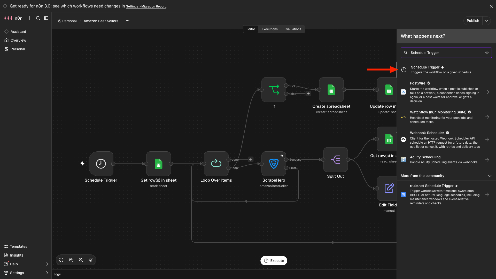

### 2. Read Category URLs from Google Sheets

The workflow needs a list of categories to process. The Google Sheets node loads that list on every run.

Add a **Google Sheets** node after the Schedule Trigger. Under **Resource**, select **Sheet Within Document**, and under **Operation**, select **Get Row(s) in Sheet**. Connect your Google Sheets account and configure:

1. **Document:** Select `Amazon Best Sellers` from the list.
2. **Sheet:** Select `Categories`.

Click **Execute Step** to confirm that the category URLs and blank tracking IDs load correctly.

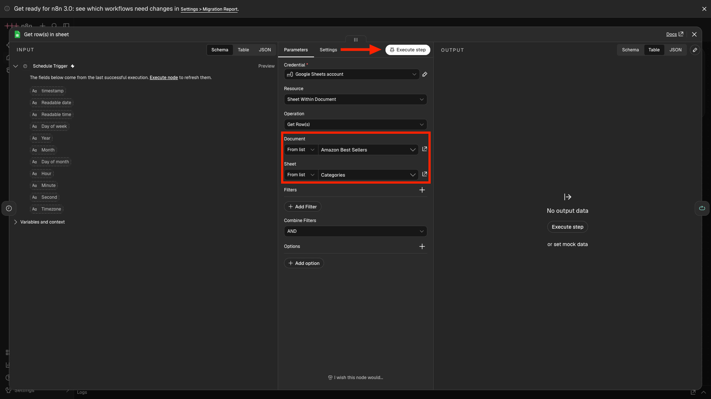

### 3. Loop Through Each Category

Best Seller requests should run one category at a time. Sequential processing keeps API usage predictable and prevents rate-limit errors.

Add a **Loop Over Items** node after the Google Sheets node. Keep the default **Batch Size** at `1`. Each category passes through the **loop** output, and the **done** output fires after the last row is processed.

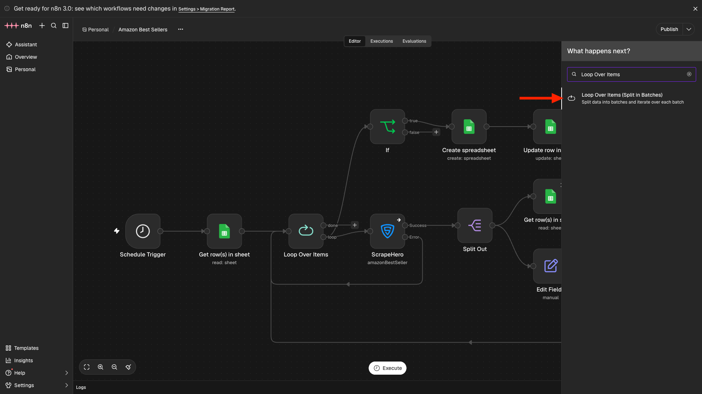

### 4. Fetch Live Rankings with ScrapeHero

The ScrapeHero community node handles the Amazon request, including proxy rotation and browser emulation, and returns structured ranking data.

Search for **ScrapeHero** in the node library and add it to the **loop** output of the Loop Over Items node.

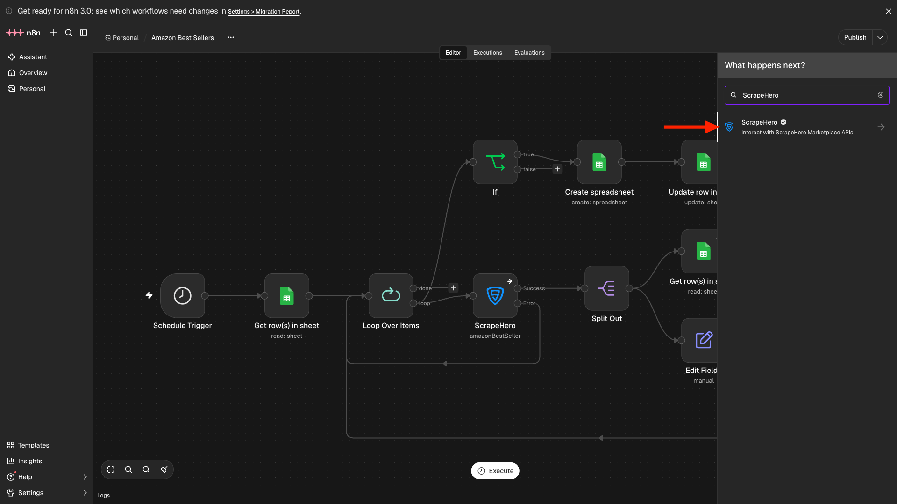

To configure the credential:

1. Go to [app.scrapehero.com](https://app.scrapehero.com/).
2. Sign in to your account.
3. Click your profile icon in the upper-right corner.
4. Open the **API Key** page.
5. Copy your API key.
6. Return to n8n and select **Create New Credential**.
7. Paste your API key into the credential field.
8. Save the credential.

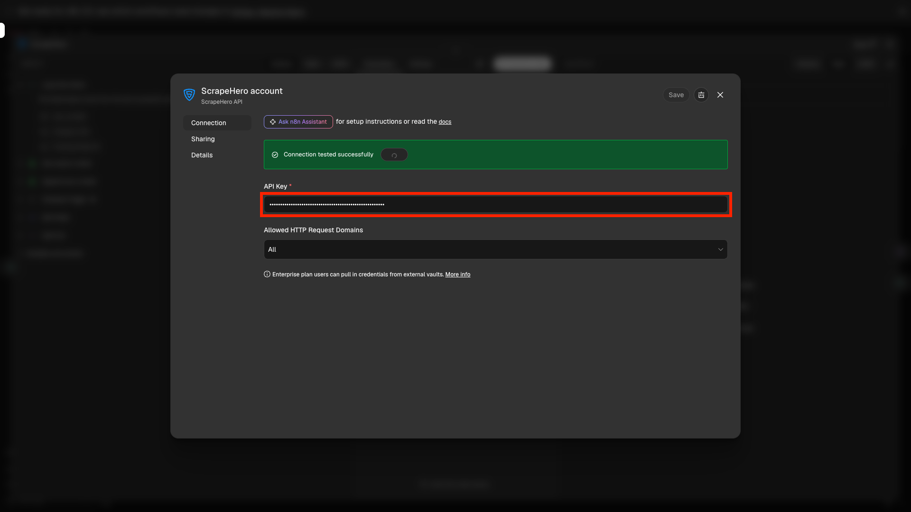

In the node parameters:

1. Set **API** to **Amazon Best Seller API**.
2. In the **Amazon Best Sellers URL** field, switch to expression mode and enter:

```javascript
={{ $json["Category URL"] }}
```

3. Leave **Page** at `1` to capture the first page of ranked products. Increase it only if you need deeper rankings.

Click **Execute Step** to test the first category. The response contains a `product_listings` array with every ranked product. Pin this output while you configure the downstream nodes so you do not spend API credits on repeated test runs.

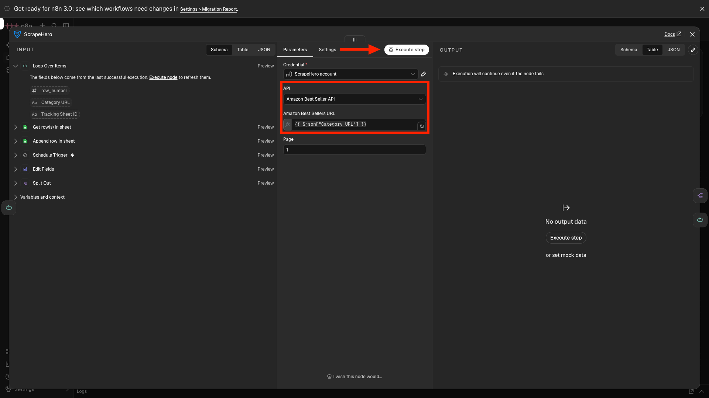

## Unpack and Map Best Seller Rankings

### 5. Split Out the Product Listings

The API returns all ranked products inside one `product_listings` array. The Split Out node turns each product into a separate item so it can become a single row in Google Sheets.

Add a **Split Out** node after the ScrapeHero node. In **Fields To Split Out**, enter:

```javascript
product_listings
```

Click **Execute Step**. Each ranked product now appears as an independent item with its own `rank`, `asin`, `name`, `ratings_count`, `rating`, `sale_price`, `image`, `is_prime`, and `product_url` fields.

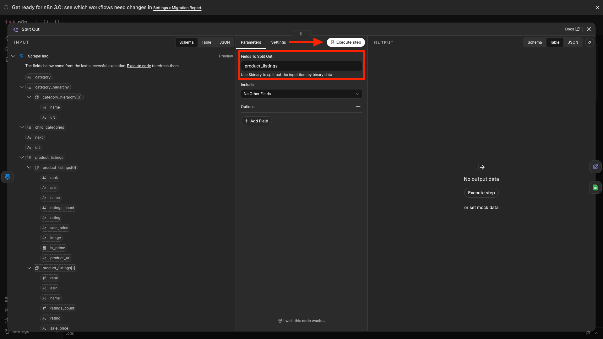

### 6. Map the Ranking Fields

Raw API keys use snake_case and include nested values that are not ideal for a spreadsheet. The Edit Fields node renames them into clean column headers and assigns the correct data types.

Add an **Edit Fields** node after the Split Out node. Add the following fields:

| Field Name | Value | Type |
| :--- | :--- | :--- |
| **Rank** | `={{ $('Split Out').item.json.rank }}` | Number |
| **ASIN** | `={{ $('Split Out').item.json.asin }}` | String |
| **Name** | `={{ $('Split Out').item.json.name }}` | String |
| **Rating Count** | `={{ $('Split Out').item.json.ratings_count }}` | Number |
| **Sale Price** | `={{ $('Split Out').item.json.sale_price }}` | String |
| **Is Prime** | `={{ $('Split Out').item.json.is_prime }}` | Boolean |
| **Product URL** | `={{ $('Split Out').item.json.product_url }}` | String |

The API also returns `rating` and `image`. Add them to the mapping if you want star ratings and thumbnails in the log.

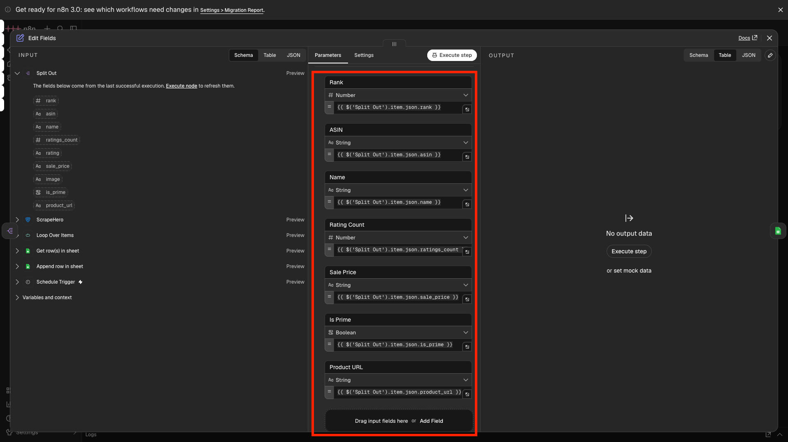

## Provision Tracking Spreadsheets and Store Snapshots

### 7. Check for an Existing Tracking Spreadsheet

Each category needs its own workbook. An If node checks whether the **Tracking Sheet ID** column is empty, which signals a category that has never been logged.

Add an **If** node to the **loop** output of the Loop Over Items node, alongside the ScrapeHero node. Configure the condition:

1. **Left Value:** `={{ $json["Tracking Sheet ID"] }}`
2. **Operator:** String `is empty`

On the first run, the condition evaluates to `true` and the workflow creates a spreadsheet. On later runs, the ID already exists and the provisioning path is skipped while the logging path continues.

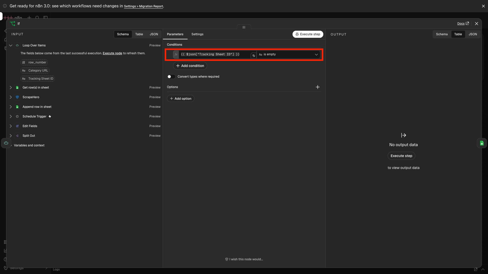

### 8. Create a Category Spreadsheet

The **Create spreadsheet** Google Sheets node builds a dedicated workbook for the current category.

Connect the `true` output of the If node to the Google Sheets node and configure:

1. **Resource:** Document
2. **Operation:** Create
3. **Title:** switch to expression mode and enter:

```javascript
={{ $('Loop Over Items').item.json["Category URL"].split('/')[3].replaceAll('-',' ') }}
```

The expression extracts the category segment from the URL and converts hyphens to spaces. A URL ending in `/Best-Sellers-Electronics/zgbs/electronics` produces a workbook named **Best Sellers Electronics**.

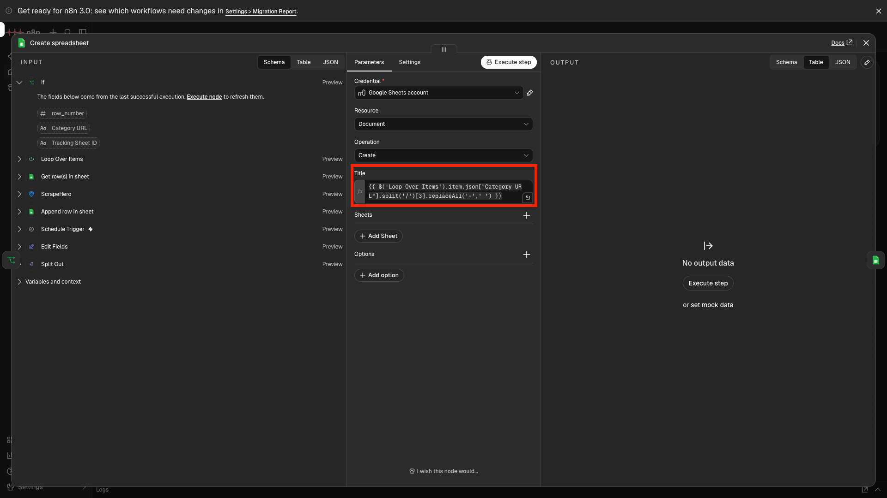

### 9. Save the Tracking Spreadsheet ID

The new spreadsheet ID must be written back to the **Categories** tab so later runs know where to append data.

Add a **Google Sheets** node after **Create spreadsheet** and configure:

1. **Resource:** Sheet Within Document
2. **Operation:** Update Row in Sheet
3. **Document:** `Amazon Best Sellers`
4. **Sheet:** `Categories`

Under **Values to Send**, map:

| Column | Expression |
| :--- | :--- |
| **Tracking Sheet ID** | `={{ $json.spreadsheetId }}` |
| **row_number** | `={{ $('If').item.json.row_number }}` |

Set **Column to match on** to **row_number**. This updates the exact row that supplied the category URL instead of appending a duplicate.

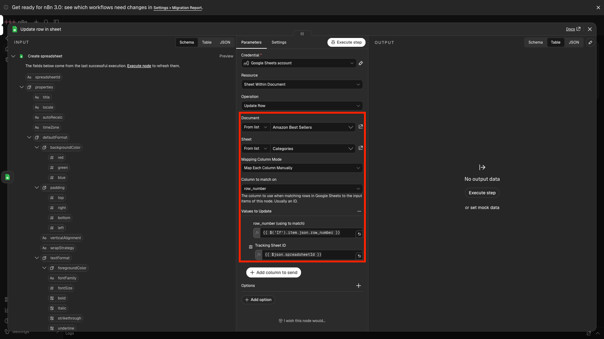

### 10. Look Up the Category Row Again

The logging path needs the saved spreadsheet ID for the current category. A second Google Sheets read resolves that value before a tab is created.

Add a **Google Sheets** node after **Split Out** and connect the output of **Update row in sheet** to it as well. Configure:

1. **Document:** `Amazon Best Sellers`
2. **Sheet:** `Categories`
3. **Filters:** Lookup Column `Category URL`, Lookup Value:

```javascript
={{ $('Loop Over Items').item.json["Category URL"] }}
```

Enable **Execute Once** in the node settings so the lookup runs a single time for the current category.

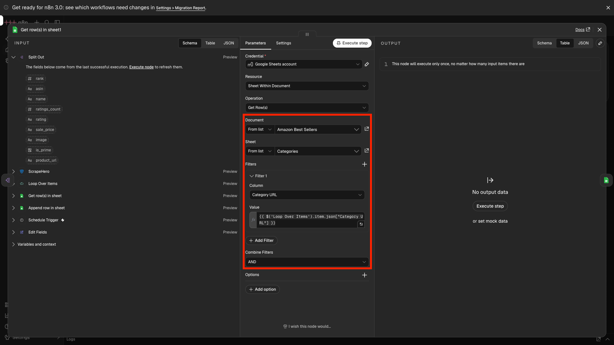

### 11. Create a Dated Tab

Every run writes to a fresh tab, which keeps each snapshot separate and prevents one execution from overwriting another.

Add a **Google Sheets** node after the category lookup and configure:

1. **Resource:** Sheet Within Document
2. **Operation:** Create
3. **Document ID:** switch to expression mode and enter:

```javascript
={{ $json["Tracking Sheet ID"] }}
```

4. **Title:** switch to expression mode and enter:

```javascript
={{ $now.format('yyyy-MM-dd::hh:mm') }}
```

The timestamp names the tab with the run date and time, such as `2026-11-18::09:30`, giving you a chronological archive inside each category workbook.

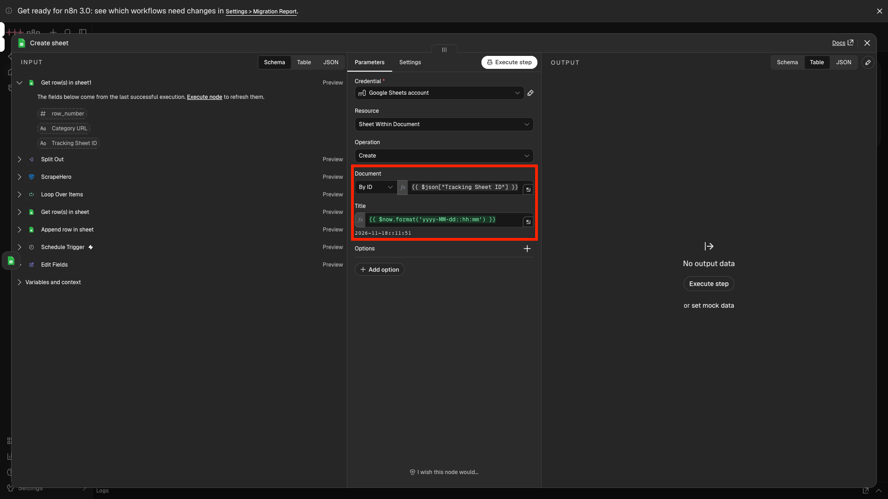

### 12. Append the Ranked Products

The final Google Sheets node writes the mapped ranking fields into the dated tab.

Add an **Append row in sheet** node and connect both **Create sheet** and **Edit Fields** to its input. Configure:

1. **Resource:** Sheet Within Document
2. **Operation:** Append Row in Sheet
3. **Document ID:** `={{ $('Create sheet').first().json.spreadsheetId }}`
4. **Sheet:** `={{ $('Create sheet').first().json.sheetId }}`
5. **Mapping Column Mode:** Map Automatically

Auto-mapping uses the field names from the Edit Fields node as column headers, so Rank, ASIN, Name, Rating Count, Sale Price, Is Prime, and Product URL land in the correct columns without manual mapping.

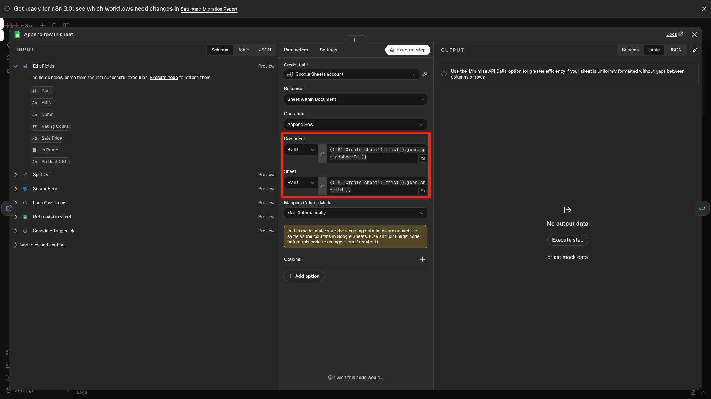

## Test and Complete the Loop

### Wire the Loop

Complete the connections so every category finishes before the next one starts:

1. Connect **Create spreadsheet** to **Update row in sheet**.
2. Connect **Update row in sheet** to **Get row(s) in sheet1**.
3. Connect **Get row(s) in sheet1** to **Create sheet**.
4. Connect **Create sheet** to **Append row in sheet**.
5. Connect **Edit Fields** to **Append row in sheet**.
6. Connect **Append row in sheet** back to **Loop Over Items**.
7. Connect the error output of **ScrapeHero** back to **Loop Over Items** so a failed category does not stall the run.

The If node's `false` output stays unconnected. When a tracking spreadsheet already exists, the provisioning path is skipped and the logging path continues through the category lookup.

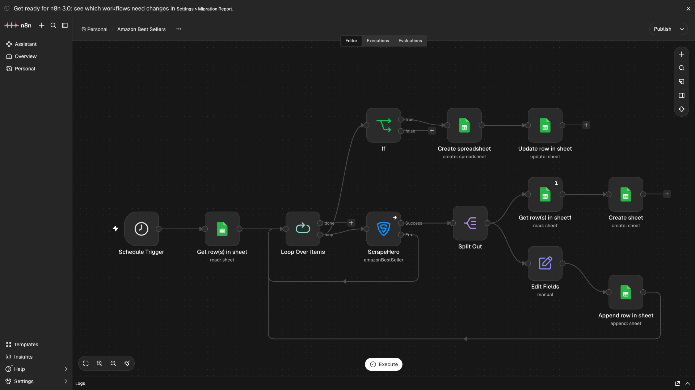

### Test the Workflow

1. Unpin any test data from the ScrapeHero node.
2. Click **Execute Workflow** at the bottom of the canvas.
3. Confirm that each category URL triggers a separate ScrapeHero request.
4. Verify that a new spreadsheet appears for the first category and that its ID is written to the **Categories** tab.
5. Open the dated tab and confirm that every ranked product has a rank, ASIN, name, rating count, sale price, Prime status, and product URL.
6. Run the workflow again and confirm that the existing spreadsheet is reused and a second dated tab is created.

Once verified, click **Publish** to activate the schedule. The workflow then logs category best sellers automatically without manual intervention.

## What This Unlocks for Your Business

An automated logger turns scattered category pages into a structured market dataset:

* **Spot rising products early.** Compare daily rank positions to identify products gaining momentum before they dominate a category.
* **Benchmark competitor pricing.** Track how sale prices change as products move up or down the Best Seller list.
* **Plan inventory and restocking.** Use sustained rank improvements as a demand signal for purchasing and fulfillment decisions.
* **Measure campaign impact.** Correlate promotions, ads, or launches with rank and rating count movements across categories.
* **Build historical BSR datasets.** Store every snapshot in Google Sheets or export it to a warehouse for trend models and dashboards.

For teams that prefer pre-built extractors over workflow maintenance, browse ready-to-use options in the [ScrapeHero Marketplace](https://www.scrapehero.com/marketplace/) and review the [data-driven Amazon ranking](https://www.scrapehero.com/data-driven-amazon-ranking/) approach.

## Next Steps

Extend the logger with these practical additions:

* **Add rating and image columns:** Map the `rating` and `image` fields in the Edit Fields node to enrich each row with star ratings and thumbnails.
* **Track more marketplaces:** Add category URLs from Amazon UK, Germany, or India to the Categories tab and let ScrapeHero resolve rankings from each regional URL.
* **Send rank-change alerts:** Add a comparison step against the previous snapshot and notify Slack or email when a tracked ASIN enters the top ten.
* **Visualize the history:** Connect the category spreadsheets to Looker Studio or Google Sheets charts to monitor rank trajectories over time.

## Wrapping Up

Logging Amazon category best sellers with n8n and ScrapeHero replaces manual page checks with a repeatable data pipeline. The workflow reads category URLs, fetches live rankings, normalizes the product fields, provisions a spreadsheet per category, and stores each snapshot in a dated tab. The result is a searchable archive of rank, price, and rating movements that supports pricing, inventory, and assortment decisions.

Sign up for a [ScrapeHero API key](https://app.scrapehero.com/) to start logging category rankings today. If your catalog needs additional fields, custom category structures, or a different request frequency, tell us your requirements and we will build a custom API around your workflow.

For enterprise teams tracking thousands of categories across global marketplaces, our managed [Amazon scraping services](https://www.scrapehero.com/amazon-scraping-services/) deliver verified data directly to your warehouse or cloud storage. Contact ScrapeHero to scale your category intelligence pipeline.

## Frequently Asked Questions

### How do I track Amazon Best Sellers automatically?

Schedule an n8n workflow that reads your category URLs from Google Sheets, calls the ScrapeHero Amazon Best Seller API for each URL, splits the `product_listings` array, and appends the ranked products to a dated Google Sheets tab. Once the workflow is published, the schedule captures every snapshot without manual work.

### Can you scrape Amazon Best Sellers with n8n?

Yes. The ScrapeHero community node connects n8n to a managed Amazon Best Seller API, so you do not need to maintain proxies, browser automation, or CAPTCHA handling yourself. Add the node, paste your API key, select **Amazon Best Seller**, and map a category URL to start collecting rankings.

### What is the Amazon Best Seller Rank (BSR)?

Amazon Best Seller Rank is a numeric position that shows how well a product sells within its category compared with other products. A rank of 1 represents the top-selling item. Lower numbers indicate stronger recent sales, and ranks shift as sales velocity changes.

### How often does Amazon update Best Seller lists?

Amazon recalculates Best Seller ranks frequently, often several times a day based on recent sales activity. Daily snapshots are enough for most trend analysis, while hourly runs suit fast-moving categories or time-sensitive promotions.

### How do I export Amazon Best Sellers to Google Sheets?

Use the workflow in this guide. The Split Out node converts each ranked product into an item, the Edit Fields node maps the fields to readable column names, and the Google Sheets append node writes every product into a dated tab. The resulting sheet can be sorted, filtered, or connected to a dashboard.

### What is the best Amazon Best Seller scraper API for n8n?

Choose an API that returns structured JSON, supports the marketplaces you sell in, and offers an official or community n8n node. ScrapeHero's Amazon Best Seller API meets those requirements and returns rank, ASIN, name, rating count, price, Prime status, and product URL in a single response.
