# How to Find the Lowest Offer Price on Amazon With n8n and ScrapeHero

Monitoring competitor pricing on Amazon means tracking every seller offer on a product, not just the featured Buy Box. An n8n Amazon price tracker for lowest price can replace manual catalog checks with a workflow that writes the market minimum straight into your tracking sheet.

This tutorial shows how to build an n8n workflow that:

1. Reads Amazon ASINs from Google Sheets  
2. Retrieves every seller offer through ScrapeHero's Amazon Offer Listing API  
3. Keeps only the offers in New condition and sorts them by price  
4. Writes the lowest price and product name back to Google Sheets

\[inlinelink\]

### What You’ll Learn

* How to find the lowest offer price on Amazon with n8n and ScrapeHero’s Amazon Offer Listing API.  
* Why the Buy Box price is not always the lowest price a product is sold at.  
* How to store ASINs, product names, and lowest prices in a Google Sheet.  
* How to process each ASIN one at a time and fetch every seller offer for it.  
* How to split the `offer_listings` array so each offer becomes its own item.  
* How to filter out used and refurbished offers and keep only New conditions.  
* How to convert text prices to numbers, and why sorting them as text gives the wrong lowest price.  
* How to sort the offers and write only the cheapest one to the sheet with the Execute Once setting.\[/inlinelink\]

## Why the Buy Box Does Not Always Show the Lowest Price

Many e-commerce teams assume that tracking an Amazon product page means tracking the Buy Box. The Buy Box (also called the Featured Offer) is not a simple lowest-price display. Amazon awards it using factors such as Fulfillment by Amazon (FBA) eligibility, shipping speed, and seller performance, along with price.

As a result, the Buy Box holder is often not the cheapest seller. Merchant-fulfilled sellers, new stores, and liquidators can list below the Buy Box price and still not win it. These offers appear only in the "Other sellers on Amazon." If you track only the featured price, you miss the true market floor.

Collecting these secondary offers by hand across hundreds of ASINs is not practical, and scraping them yourself runs into [Amazon web scraping challenges](https://www.scrapehero.com/amazon-web-scraping-challenges/). 

[Amazon scraping APIs](https://www.scrapehero.com/amazon-scraping-apis/) solve this by returning structured JSON with every seller, price, condition, and fulfillment method in a single request. Price is only one part of the picture. For the ranking side, read about [data-driven Amazon ranking](https://www.scrapehero.com/data-driven-amazon-ranking/).

## Before You Begin

Before creating the workflow to find the lowest offer price on Amazon with n8n, prepare the following:

1. An n8n account or self-hosted [n8n installation](https://docs.n8n.io/choose-how-to-use-n8n).  
2. A Google [Cloud OAuth client ID and client secret](https://support.google.com/cloud/answer/15549257?hl=en).  
3. A Google Sheets document titled **Lowest New Price** with a tab named **ASINs**.  
4. A [ScrapeHero account and API key.](https://app.scrapehero.com/docs/API-docs/authentication/)

Your ASINs tab should contain these columns:

| ASIN | Name | Lowest New Price |
| :---- | :---- | :---- |
| B08141GQQG | Logitech G733 LIGHTSPEED Headset | 119.00 |

## Create the Workflow

### 1\. Add a Manual Trigger

On your n8n dashboard, click "Create Workflow" to open a new canvas with a big plus sign in the center.

Click the **plus icon**, search for **Manual Trigger**, and click it to add it to the workflow. Keep the default configuration. A manual trigger lets you test the workflow on demand. You can replace it with a schedule later.

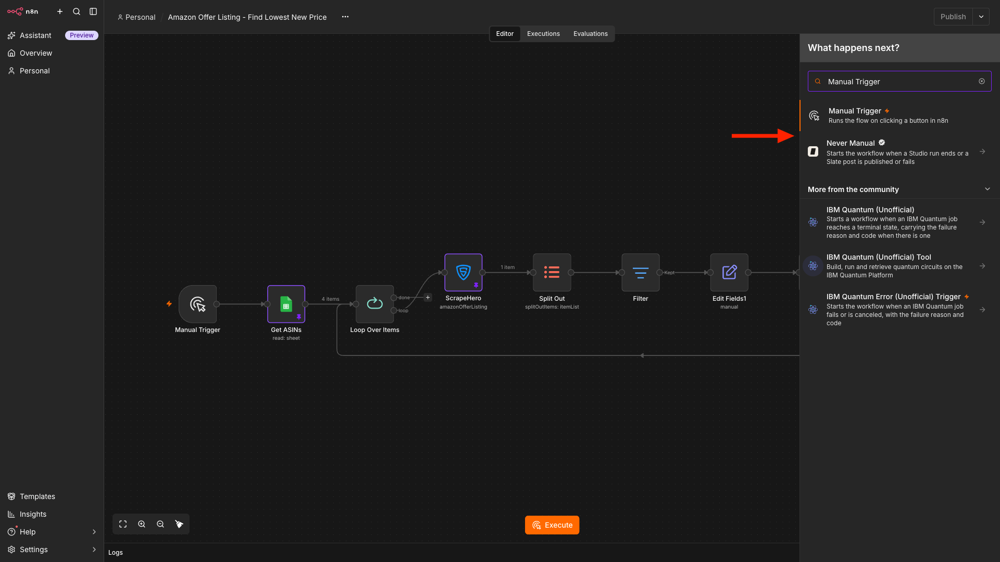

### 2\. Read ASINs from Google Sheets

Click the **plus icon** to the right of the Manual Trigger, search for **Google Sheets**, and click to add the node. (This is similar to all the other nodes in this tutorial)

For the Sheet action, choose **Get Row(s) in Sheet**.

Next, click **Connect to Google Sheets**. Paste your Google Cloud **Client ID** and **Client Secret**, then click **Sign in with Google**. Complete the authorization process and return to n8n.

Now select:

1. The **Lowest New Price** document.  
2. The **ASINs** tab.

Rename the node to **Get ASINs** and click **Execute Step** to confirm that the ASIN rows load.

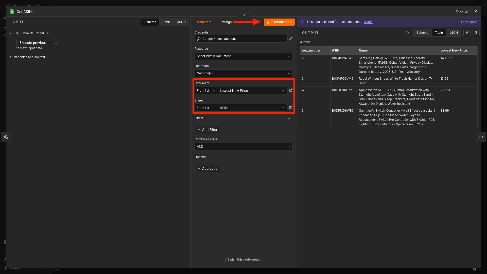

### 3\. Process Each ASIN Individually

Each ASIN needs its own request to the ScrapeHero API. Processing them one at a time also avoids rate limit problems on large catalogs.

To do so, add a **Loop Over Items** node. Click the **plus icon** to the right of the Get ASINs node, search for **Loop Over Items**, and click it. Set the **Batch Size** to 1\.

This node has two outputs. The **loop** output runs for each item, and the **done** output runs after all items finish.

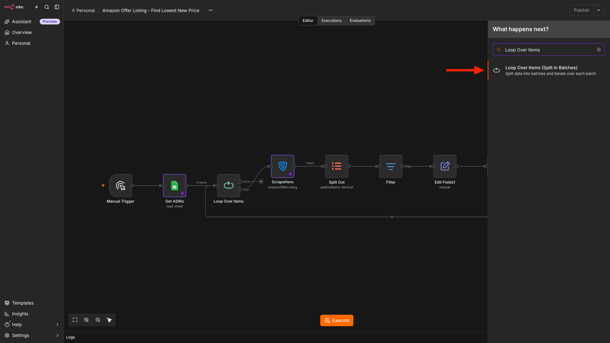

### 4\. Add the ScrapeHero Node

Next, add the ScrapeHero node to the **loop** output of the Loop Over Items node.

If you are adding the node for the first time, you need to install the ScrapeHero community node first.

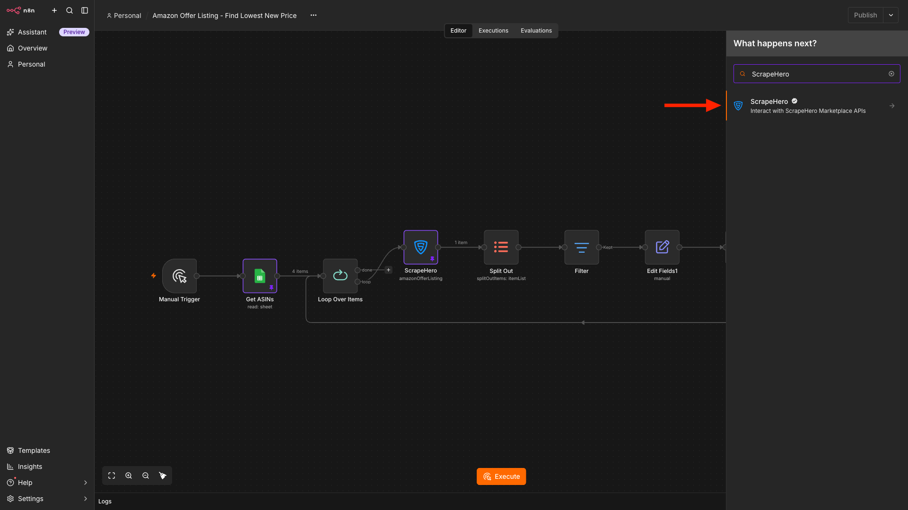

In the configuration window, click **Connect ScrapeHero** to create the credentials. Then:

1. Go to [app.scrapehero.com](https://app.scrapehero.com/).  
2. Sign in to your account.  
3. Click your profile icon.  
4. Open **API Key**.  
5. Copy your API key.  
6. Return to n8n.  
7. Paste the key into the ScrapeHero credential field.  
8. Save the credentials.

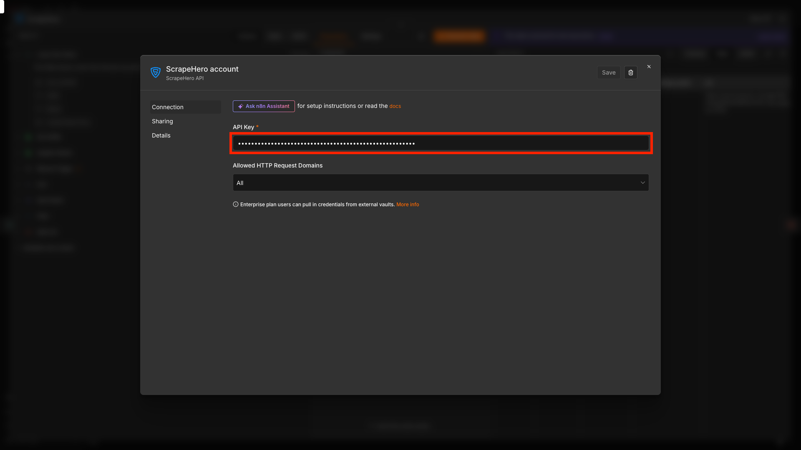

Select **Amazon Offer Listing** from the API dropdown. This API returns every active seller offer for a product.

Locate the **ASIN** field, switch to the expression editor, and drag the **ASIN** value from the Loop Over Items node into it, or enter:

{{ \$json.ASIN }}

Select the Country Code and click **Execute Step** to test the request for the first ASIN.

The response includes `asin`, `product_title`, `product_rating`, `product_ratings_count`, and an array named `offer_listings` that holds every seller offer.

After the test succeeds, pin the output temporarily. Pinning prevents repeated test executions from making unnecessary API requests while you configure the remaining nodes. To pin the output, click the pin icon at the top right of the output panel. Unpin it before the final test.

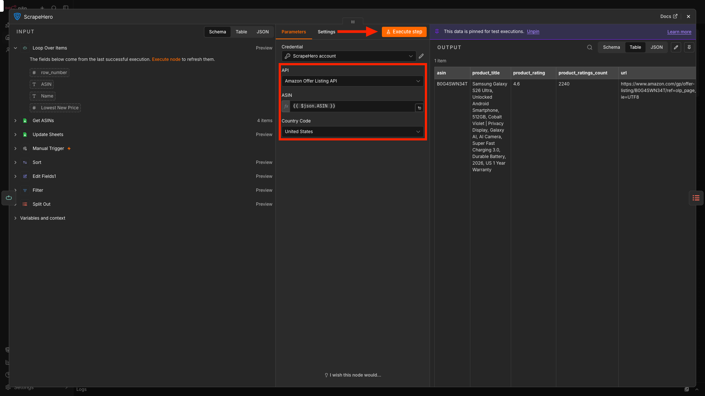

## Prepare the Offers

### 5\. Split the Offers into Separate Items

The `offer_listings` field is an array nested inside a single item. To filter and sort individual offers, convert each array element into its own item.

Add a **Split Out** node after the ScrapeHero node. In the **Fields To Split Out** box, enter:

offer\_listings

Click **Execute Step**. The single product item becomes one item per offer, each containing fields such as `price`, `condition`, `seller`, `ships_from`, and `fulfilled_by_amazon`.

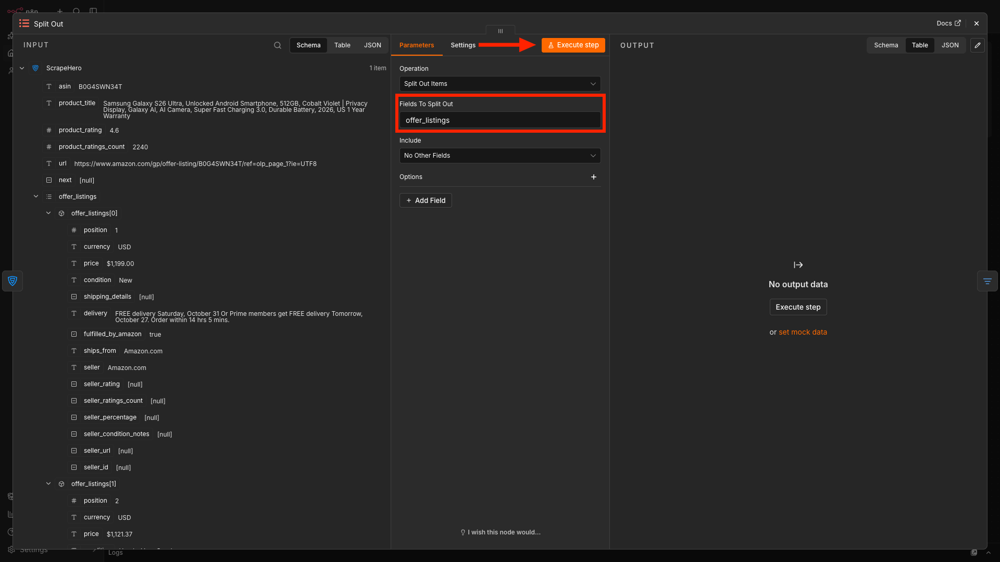

### 6\. Keep Only New Offers

Sellers list products in different conditions, such as New, Used \- Like New, Used \- Very Good, and Refurbished. If you want the lowest **new** price, the cheapest offer overall can be misleading.

For example, in the sample response for the Logitech headset (B08141GQQG), the two lowest prices are \$64.02 (Used \- Very Good) and \$66.02 (Used \- Like New). The lowest New offer is \$119.00. Comparing new stock with open-box deals distorts your pricing data.

Add a **Filter** node after the Split Out node and set one condition:

1. `{{ $json.condition }}` **is equal to** `New`

Only new offers continue to the next node.

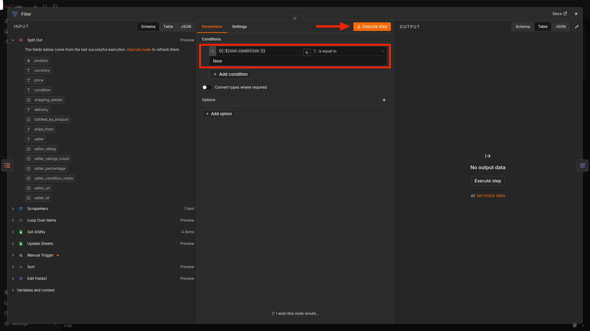

### 7\. Convert the Price to a Number

The API returns prices as text with a currency symbol, such as "\$119.48". Add an **Edit Fields** node after the Filter node and create a field named `Price` with the type **Number**.

Paste this expression into the field:

{{ Number(\$json.price.replace(/\[^0-9.\]/g, '')) }}

The conversion matters because of how text is sorted. Sorted as text, "\$119.48" comes before "\$64.02" because the character "1" comes before "6". The workflow would then report \$119.48 as the lowest price. As a number, 64.02 correctly sorts below 119.48.

Rename the node to **Edit Fields1**.

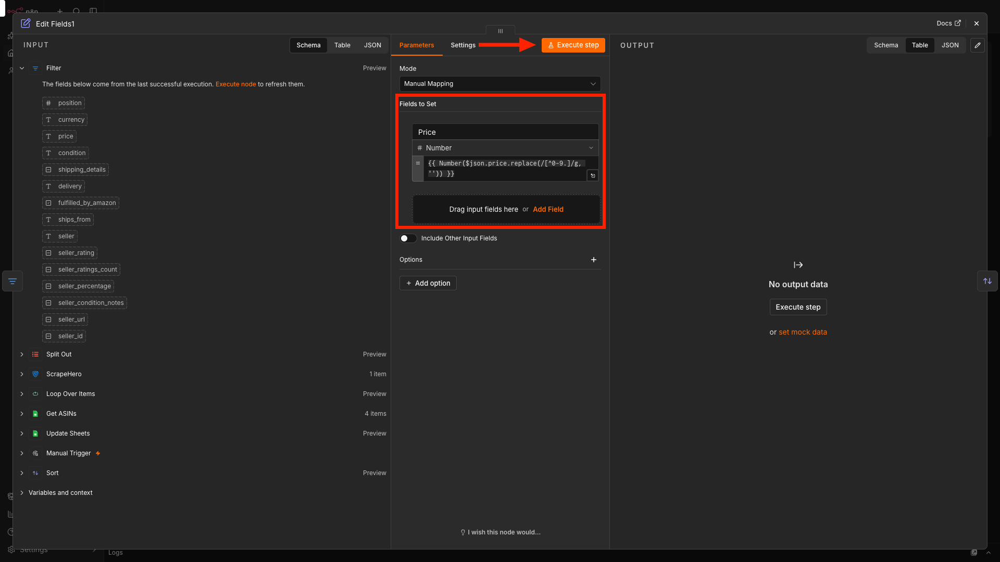

### 8\. Sort the Offers

Add a **Sort** node after Edit Fields1. Under **Sort Fields**, click **Add Field** and set:

1. **Field Name:** `Price`  
2. **Order:** Ascending

The cheapest offer is now the first item in the list.

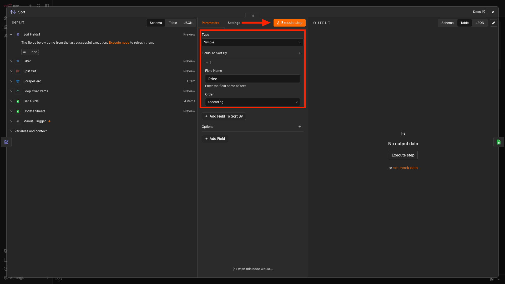

## Update the Google Sheet

### 9\. Write the Lowest Price to the Sheet

Add a **Google Sheets** node after the Sort node. For the action, choose **Append or Update Row in Sheet**.

Select the **Lowest New Price** document and the **ASINs** tab, then set **Mapping Column Mode** to **Map Manually**. For the matching column, choose **ASIN**. This updates the existing row instead of creating a duplicate.

Map the columns as follows:

1. **ASIN:**

{{ \$('ScrapeHero').item.json.asin }}

2. **Name:**

{{ \$('ScrapeHero').item.json.product\_title }}

3. **Lowest New Price:**

{{ \$json.Price }}

After the Split Out node, each item holds only offer-level fields, so the ASIN and product name must come from the ScrapeHero node.

Finally, open the node's **Settings** tab and turn on **Execute Once**. Without it, the node runs for every offer and the last (and most expensive) item overwrites the row. With it, the node runs only for the first item, which is the lowest price.

Rename the node to **Update Sheets**.

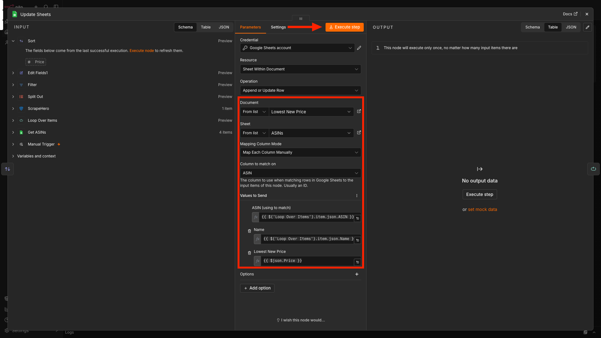

## Test and Complete the Loop

### Connect the Loop

Connect the output of the **Update Sheets** node back to the **Loop Over Items** node. This tells the loop to continue with the next ASIN.

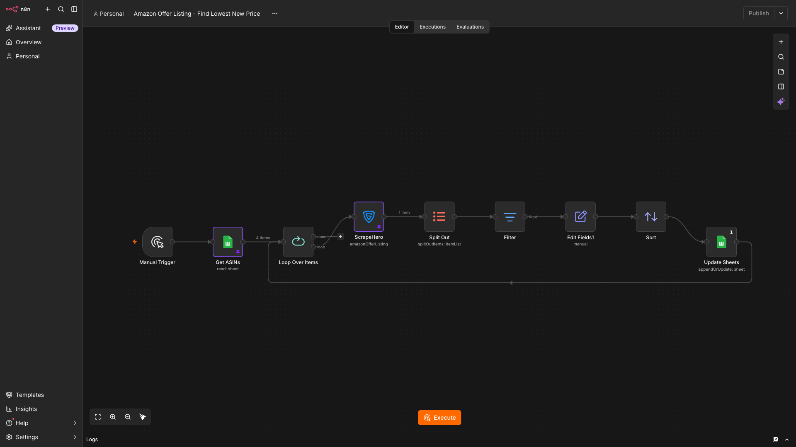

### Test the Workflow

Unpin all the pinned outputs and click **Execute Workflow** at the bottom of the canvas.

For each ASIN, n8n will:

1. Fetch every seller offer through ScrapeHero.  
2. Split the offers into separate items.  
3. Remove offers that are not in New condition.  
4. Convert prices to numbers and sort them in ascending order.  
5. Update the matching row with the product name and the lowest price.  
6. Move on to the next ASIN.

Open your Google Sheet and confirm that the Name column shows the full product title and the Lowest New Price column shows the lowest price.

## What This Unlocks for Your Business

Tracking every seller offer instead of only the Buy Box helps you:

- **Reprice against the real market.** See which merchant-fulfilled sellers undercut the Buy Box, so you can set repricing limits based on actual competition.  
- **Enforce MAP policies.** Spot resellers and liquidators who list your products below your Minimum Advertised Price.  
- **Find sourcing opportunities.** Spot secondary-seller discounts that create arbitrage and wholesale margin opportunities.  
- **Track discounting trends.** Record price floors over time to anticipate competitor clearance cycles and promotions.  
- **Catch Buy Box risk early.** See when a competitor drops their price before the featured offer changes, so your team has time to respond.

Prefer not to handle API integration? Check out the [ScrapeHero Cloud Amazon scrapers](https://www.scrapehero.com/marketplace/) instead.

## Next Steps

You can extend this workflow with:

- **Price drop alerts**: Add an **If** node after the Sort node that checks whether the lowest price is below your threshold, for example `{{ $json.Price < 100 }}`. Connect the true branch to a Slack or Gmail node.  
    
- **Scheduled runs**: Replace the Manual Trigger with a **Schedule Trigger** and run the workflow every morning. Choose the interval based on how fast prices change in your category and how many API credits you want to use.  
    
- **Seller filters**: Add a condition in the Filter node to keep only sellers you trust, such as `{{ $json.fulfilled_by_amazon === true }}`, or use the seller rating if the response includes it.  
    
- **Margin calculation**: Add a `Cost` column to your sheet and calculate the spread in the Edit Fields node. This shows whether you can profitably undercut the lowest market offer.

{{ (\$json.Price \- \$('Get ASINs').item.json.Cost).toFixed(2) }}

\[inlinelink\]Want to read more n8n tutorials like these? Check out this [resource](https://www.scrapehero.com/web-scraping-using-scrapehero-cloud/n8n/).\[/inlinelink\]

## Wrapping Up

Tracking the lowest Amazon offer price doesn't have to be a manual, error-prone process. You can use ScrapeHero's Amazon Offer Listing API and automate the lowest price tracking with n8n.

The ScrapeHero API, accessed via the ScrapeHero node, handles the data extraction part. You just have to focus on building the workflow that improves your business.

Sign up for a [ScrapeHero API key](http://app.scrapehero.com) and build your price tracking workflow. Do you want additional data points? Tell us your requirements, and we will build a custom API just for you. 

ScrapeHero is your \#1 [web scraping service provider](https://scrapehero.com) for fully outsourcing data extraction. For catalogs with hundreds of thousands of ASINs across international marketplaces, our fully managed [Amazon scraping services](https://www.scrapehero.com/amazon-scraping-services/) handle proxy rotation, anti-bot measures, data validation, and delivery to your data warehouse. Contact ScrapeHero today to get started.

## Frequently Asked Questions

### How do you find the lowest offer price on Amazon instead of the Buy Box price?

Use the Amazon offer listing page (`/gp/offer-listing/ASIN`), which lists all sellers for a product. The standard product page shows only the Buy Box winner. ScrapeHero's Amazon Offer Listing API returns every seller offer as JSON, so you can sort and compare them in n8n.

### Can you scrape Amazon offer listings with n8n?

Yes. You can use the ScrapeHero community node in n8n to get Amazon search results, product details, and offer listings. The node sends the request to the ScrapeHero API, so you don't have to manage proxies or browsers yourself, as you would with a plain HTTP Request node.

### How often should you track Amazon offer prices?

It depends on how quickly prices change in your category. Fast-moving categories need more frequent runs. For stable catalogs, a daily run is usually enough and uses fewer API credits. Use the Schedule Trigger to set the interval.  
