# How to Track Amazon Discounts With n8n and ScrapeHero

Finding Amazon discounts by hand means opening search pages, noting prices, and repeating the process every day. That does not scale for sellers, affiliates, or deal hunters. Build an n8n Amazon discount tracker to run the searches on a schedule and log only the products that are actually discounted.

This tutorial shows how to build an n8n workflow that:

1. Reads search keywords from Google Sheets  
2. Fetches Amazon search results through ScrapeHero's Amazon Search API  
3. Keeps only the products that have both a sale price and a regular price  
4. Calculates the discount percentage and saves each deal to a Google Sheets tab named with the day's date

\[inlinelink\]

### What You’ll Learn

* How to build an Amazon discount tracker with n8n and ScrapeHero’s Amazon Search API.  
* How to store search keywords in a Google Sheets tab and read them into the workflow.  
* How to run the workflow once a day and create a new tab named with the day’s date for each run.  
* How to process each keyword one at a time and fetch its Amazon search results.  
* How to split the search results so every product becomes its own item.  
* How to keep only products that have both a `sale_price` and a `regular_price`.  
* How to calculate the `% OFF` for each deal in the Edit Fields node.  
* How to save each deal to the dated tab, and how to use ASIN to avoid duplicate rows.  
* How to keep the loop running when a keyword returns no discounted products.  
* How to test the workflow and publish it.\[/inlinelink\]

## Before You Begin

Before creating the workflow to track Amazon discounts with n8n, prepare the following:

1. An n8n account or self-hosted [n8n installation](https://docs.n8n.io/choose-how-to-use-n8n).  
2. A Google [Cloud OAuth client ID and client secret](https://support.google.com/cloud/answer/15549257?hl=en).  
3. A Google Sheets document with a tab named **Keywords**.  
4. A [ScrapeHero account and API key.](https://app.scrapehero.com/docs/API-docs/authentication/)

The Keywords tab needs one column with the header **Keyword**:

| Keyword |
| :---- |
| smart watches |
| wireless headphones |
| robot vacuum |

 

## Create the Workflow

### 1\. Add a Schedule Trigger

On your n8n dashboard, click "Create Workflow" to open a new canvas with a big plus sign in the center.

Click the **plus icon**, search for **Schedule Trigger**, and click it to add it to the workflow. Adding the node opens its configuration window.

The Schedule Trigger decides how often n8n looks for discounts. Set it to run once a day, for example at 06:00.

The workflow creates a tab named with the current date, and a second run on the same day would try to create a tab that already exists.

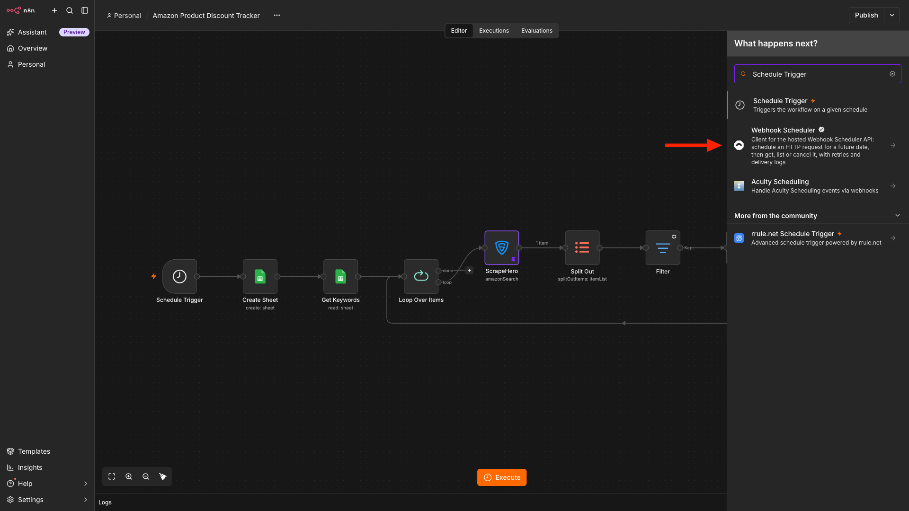

### 2\. Create a Dated Sheet

After closing the configuration window, click the **plus icon** to the right of the Schedule Trigger, search for **Google Sheets**, and add the node.

For the action, choose **Create Sheet**.

Next, click **Connect to Google Sheets**. Paste your Google Cloud **Client ID** and **Client Secret**, then click **Sign in with Google**. Complete the authorization and return to n8n.

Now select:

1. Your Google Sheets document as the **Document**.  
2. The following expression as the **Title**:

{{ \$now.format('yyyy-MM-dd') }}

This creates a new tab named after today's date, such as 2026-10-11. Each run gets its own tab, so you keep a historical snapshot of the discounts for every day.

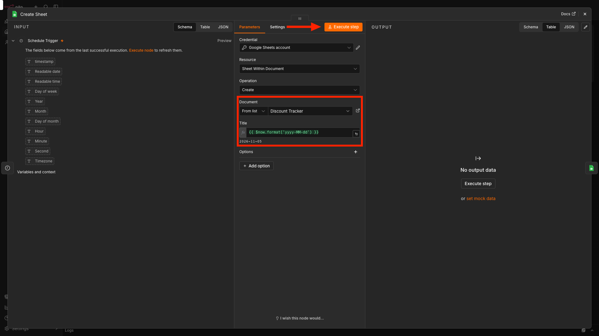

### 3\. Read the Keywords

Add another **Google Sheets** node after the Create Sheet node. For the action, choose **Get Row(s) in Sheet.** The credentials you created earlier are already available.

Inside the node, select:

1. The same Google Sheets document.  
2. The **Keywords** tab.

The node reads every row and passes each keyword to the next node.

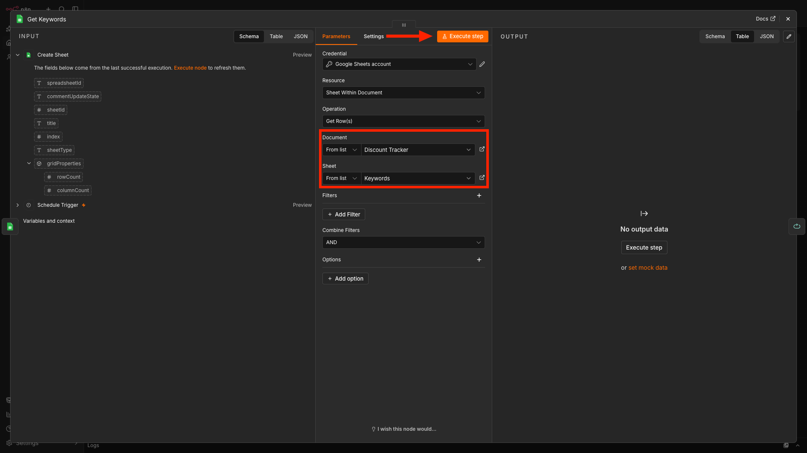

### 4\. Process Each Keyword Individually

Each keyword needs its own request to the ScrapeHero API. To process them one at a time, add a **Loop Over Items** node.

Click the **plus icon** to the right of the Google Sheets node, search for **Loop Over Items**, and click it. Set the **Batch Size** to 1\.

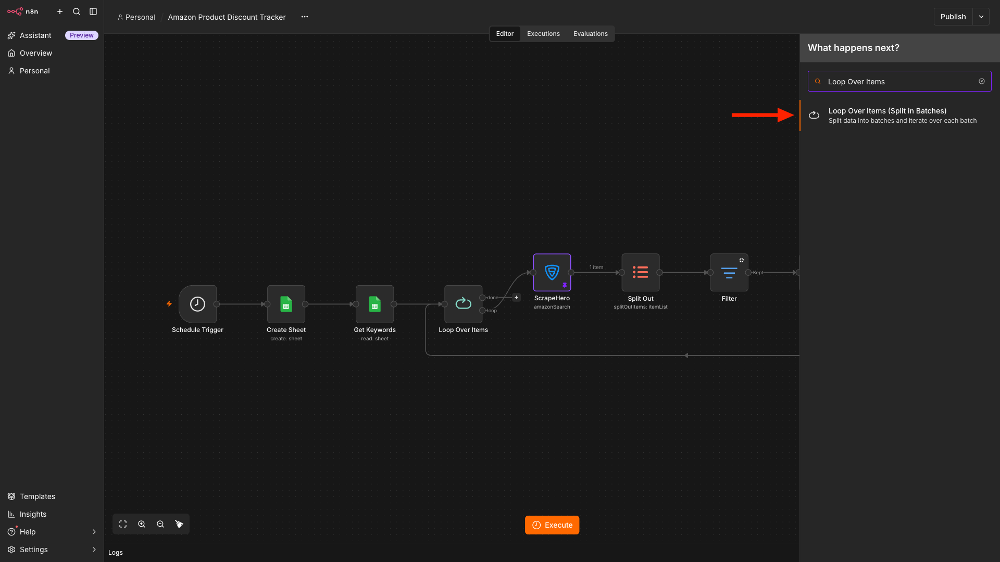

### 5\. Add the ScrapeHero Node

Next, add the ScrapeHero node to the **loop** output of the Loop Over Items node.

If you are adding the node for the first time, you need to install the ScrapeHero community node first.

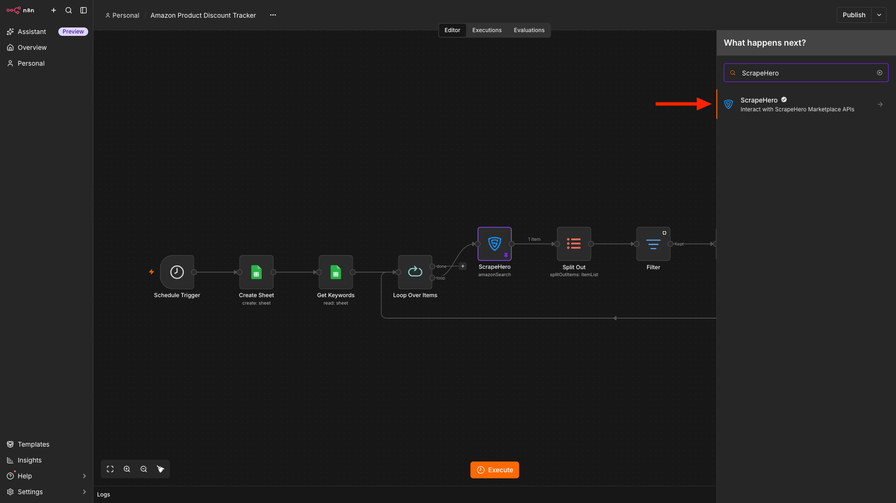

In the configuration window, click **Connect ScrapeHero** to create the credentials. Then:

1. Go to [app.scrapehero.com](https://app.scrapehero.com/).  
2. Sign in to your account.  
3. Click your profile icon.  
4. Open **API Key**.  
5. Copy your API key.  
6. Return to n8n.  
7. Paste the key into the ScrapeHero credential field.  
8. Save the credentials.

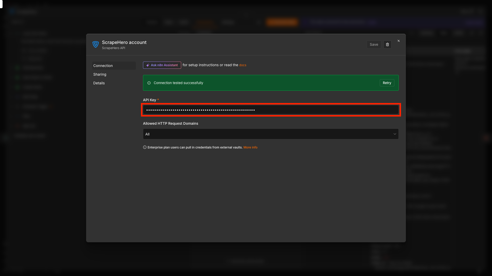

Select **Amazon Search API** from the API dropdown. This API returns structured search results, including product names, ASINs, prices, and product URLs.

### 6\. Configure the API Request

Locate the keyword input field and drag the **Keyword** value from the Loop Over Items node into it. This creates an expression that sends every keyword in the sheet to the API, one at a time.

Then:

1. Select the **Country Code** (for example, US).  
2. Set the number of **pages** to retrieve for each keyword.

The number of pages directly affects how many credits each run uses. Start with a small number while testing.

Click **Execute Step** to test the request. The output contains the `query`, `search_results`, and `next_page` fields.

After the test succeeds, pin the output temporarily. Pinning prevents repeated test executions from making unnecessary API requests while you configure the remaining nodes.

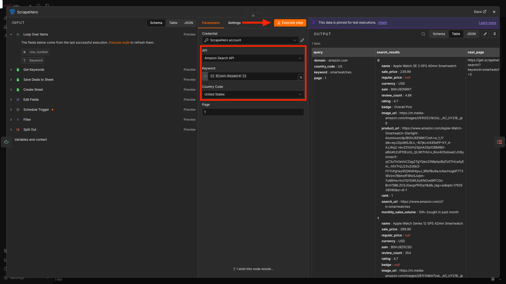

## Filter and Format the Deals

### 7\. Split the Search Results

The `search_results` field is an array that holds every product from the search. To work with each product separately, add a **Split Out** node after the ScrapeHero node.

In the **Fields To Split Out** box, enter:

search\_results

Each product now becomes its own item in the workflow.

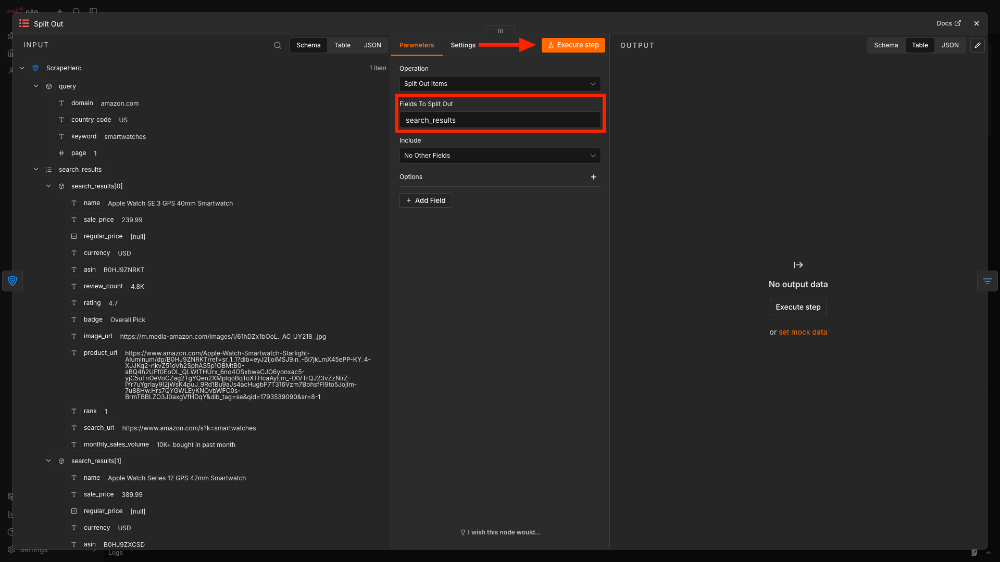

### 8\. Keep Only the Discounted Products

Not every search result is on sale. A discounted product has both a sale price and a regular price, so use these two fields to separate real discounts from regular listings.

Click the **plus icon**, search for **Filter**, and add the node after the Split Out node.

Add two conditions and set the combinator to **AND**:

1. `sale_price` **is not empty**  
2. `regular_price` **is not empty**

Only products that meet both conditions continue to the next node.

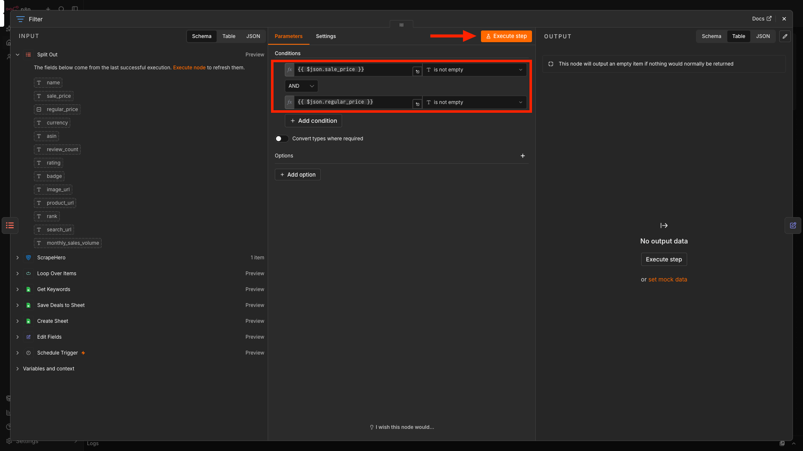

### 9\. Map the Fields and Calculate the Discount

Add an **Edit Fields** node after the Filter node.

Add the following fields and drag the matching values from the Filter output into each one:

| Output Field | Value |
| :---- | :---- |
| `ASIN` | `asin` |
| `Name` | `name` |
| `Sale Price` | `sale_price` |
| `Regular Price` | `regular_price` |
| `Product URL` | `product_url` |

Then add a sixth field named `% OFF` and paste this expression:

{{ ((\$json.regular\_price \- \$json.sale\_price) / \$json.regular\_price \* 100).round(2) }}

The expression subtracts the sale price from the regular price, divides the result by the regular price, multiplies by 100, and rounds the answer to two decimal places.

**Note:** The formula works only if both prices are numbers. If your output shows prices as text with a currency symbol, such as "\$129.95", remove the symbol and convert the value first, using `.replace('$','').toNumber()`.

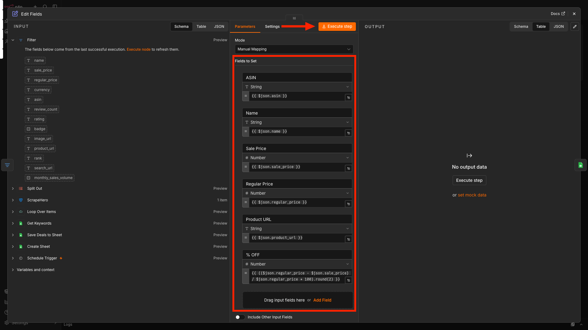

## Save the Deals to Google Sheets

### 10\. Add the Deals to the Dated Tab

Add a **Google Sheets** node after the Edit Fields node and choose **Append or Update Row in Sheet** as the action.

Select your document, then set the **Sheet** field to **By ID** and paste this expression:

{{ \$('Create Sheet').item.json.sheetId }}

This points the node at the tab created in step 2, so you do not need to hardcode the tab name.

Set **Mapping Column Mode** to **Map Automatically**, and choose **ASIN** as the column to match on.

Matching on ASIN prevents duplicate rows when the same product appears under more than one keyword in the same run. If the ASIN already exists in the tab, n8n updates that row instead of adding a new one.

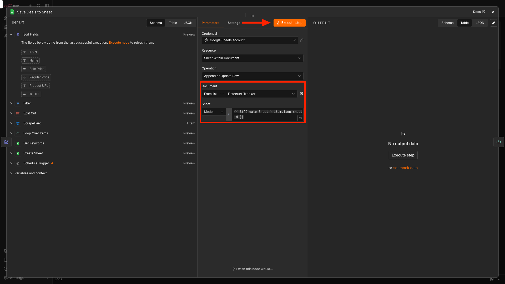

## Test and Complete the Loop

### Connect the Loop

Connect the output of the Google Sheets append node back to the **Loop Over Items** node. This tells the loop to continue with the next keyword.

If a keyword returns no discounted products, the Filter node passes nothing forward and the loop would stop. Open the Filter node's settings and enable **Always Output Data**, or add a branch that returns to the Loop Over Items node, so the workflow moves on to the next keyword.

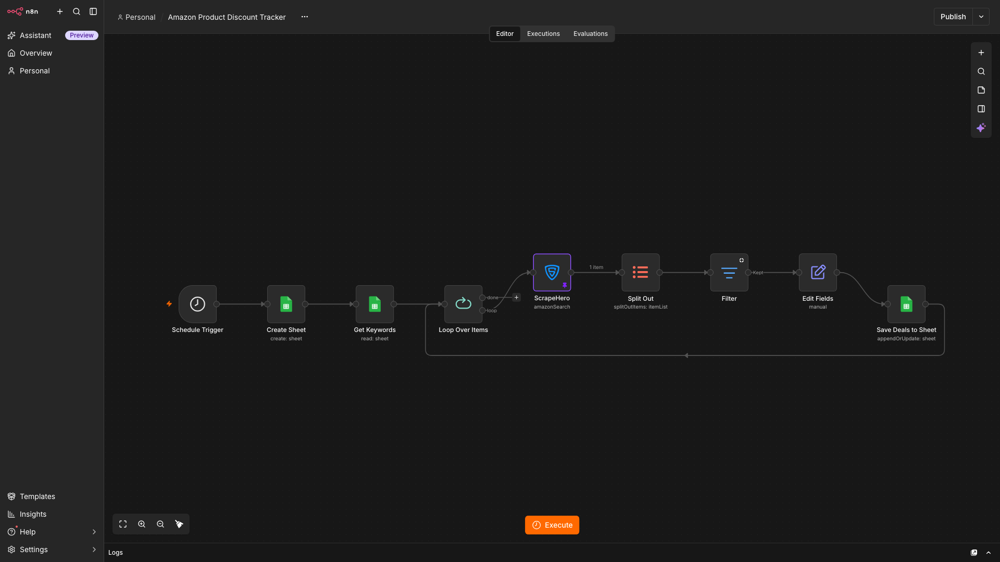

### Test the Workflow

Unpin all the pinned outputs and click **Execute Workflow** at the bottom of the canvas.

When the run finishes, open your Google Sheets document. You should see a new tab named with today's date, with these columns filled in for every keyword:

- ASIN  
- Name  
- Sale Price  
- Regular Price  
- % OFF  
- Product URL

Check that no row has an empty Regular Price. That confirms the filter works.

### Publish the Workflow

Confirm that there are no errors. When everything works as expected, publish the workflow.

From then on, n8n will:

1. Run at the configured schedule.  
2. Create a new tab named with the date.  
3. Read the keywords from Google Sheets.  
4. Search Amazon for each keyword through ScrapeHero.  
5. Keep only the products with both a sale price and a regular price.  
6. Calculate the discount percentage.  
7. Save each deal to the dated tab.

## What This Unlocks for Your Business

Building this workflow to track Amazon discounts with n8n helps you:

- **Eliminate manual price checks.** No more opening Amazon search pages every day. The workflow searches every keyword automatically.  
- **Build a historical discount log.** Each run creates a dated tab, which gives you data for trend analysis and for spotting promotional cycles.  
- **Cover more keywords without changing the workflow.** Adding a keyword is as simple as adding a row to the Keywords tab.  
- **Separate real discounts from regular listings.** The filter keeps only products that show both a sale price and a regular price.  
- **Track competitors and find deals.** Affiliates can feed discounted products to deal sites, and sellers can see how rival listings are priced.  
- **Skip the scraper maintenance.** ScrapeHero handles data extraction, so you can focus on what to do with the data.

Prefer not to handle API integration? Check out the [Amazon Search Scraper](https://www.scrapehero.com/marketplace/) on ScrapeHero Cloud instead.

## Next Steps

You can extend this workflow with:

- **Price-drop alerts**: Add an If node after Edit Fields. If `% OFF` is above your threshold (for example, 20), send a Slack, Telegram, or Gmail notification.  
    
- **Stale deal cleanup**: Compare each tab against the latest results and remove ASINs that are no longer discounted.  
    
- **Multi-country tracking**: Duplicate the ScrapeHero node for each country code (such as US, CA, UK, and DE) and combine the results.  
    
- **Dashboards**: Connect Google Sheets to Looker Studio or Power BI to visualize discounts over time.  
    
- **Product enrichment**: Send the ASINs to ScrapeHero's Amazon Product Details and Pricing API to add specifications, images, and reviews.  
    
- **Competitor tracking**: Add a "Competitor ASIN" column to the Keywords tab and keep only the results that match those ASINs.

## Wrapping Up

Tracking Amazon discounts at scale doesn't have to be a manual process. You can use ScrapeHero's Amazon Search API and automate discount tracking with n8n.

The ScrapeHero API, accessed via the ScrapeHero node, handles the data extraction. You just have to focus on building the workflow that improves your business.

Sign up for a [ScrapeHero API key](http://app.scrapehero.com) and build your discount tracker. Do you want additional data points? Tell us your requirements, and we will build a custom API just for you.

ScrapeHero is your \#1 [web scraping service provider](https://scrapehero.com) for fully outsourcing data extraction. We combine automated scraping power with human-in-the-loop oversight to ensure maximum accuracy. Contact ScrapeHero today to get started.  
