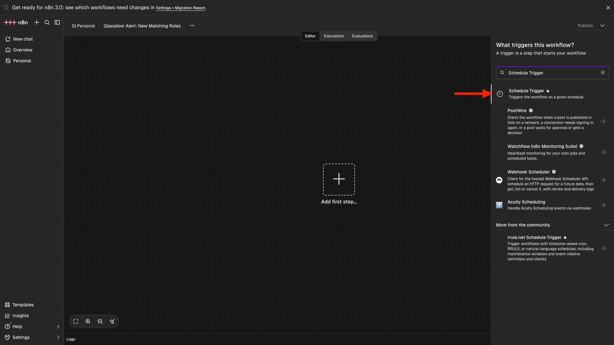
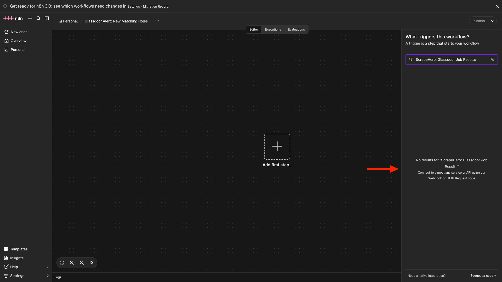
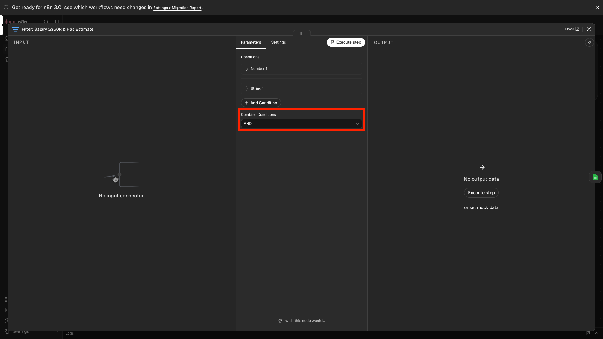
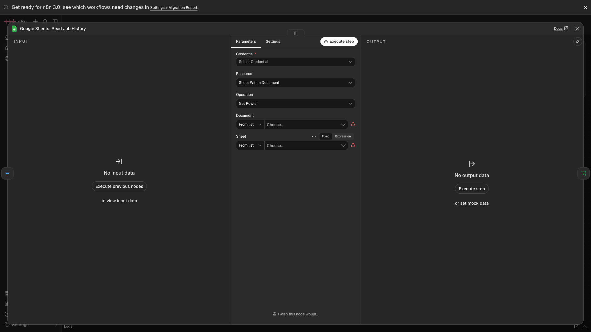
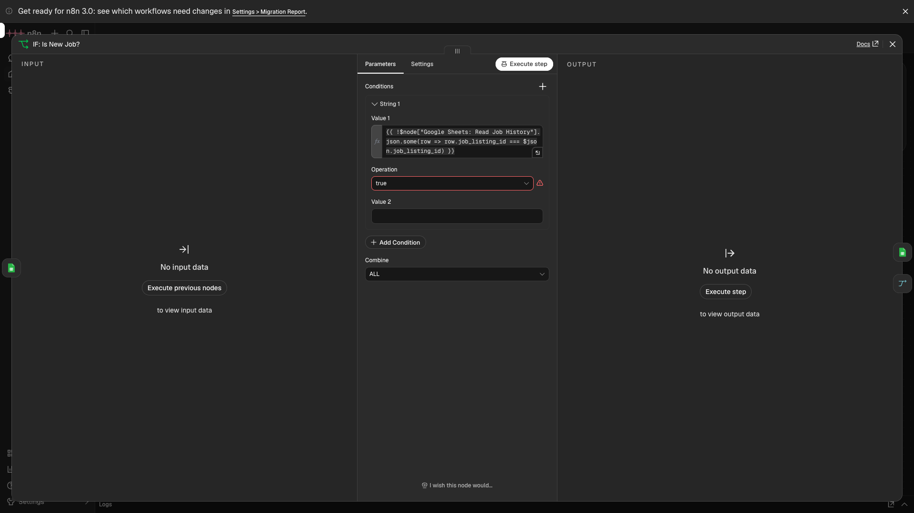
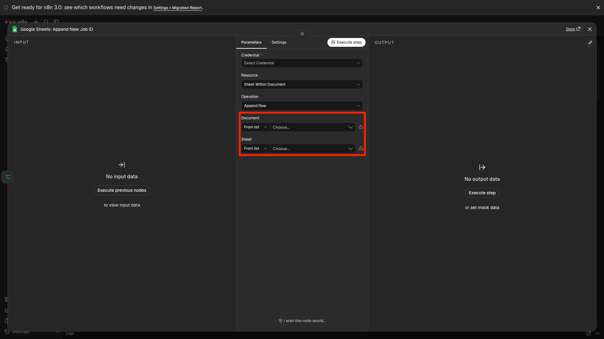
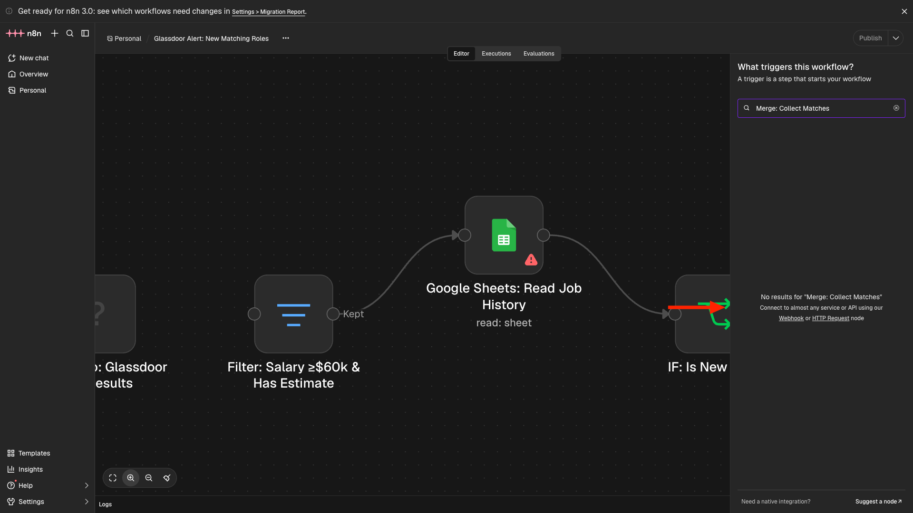
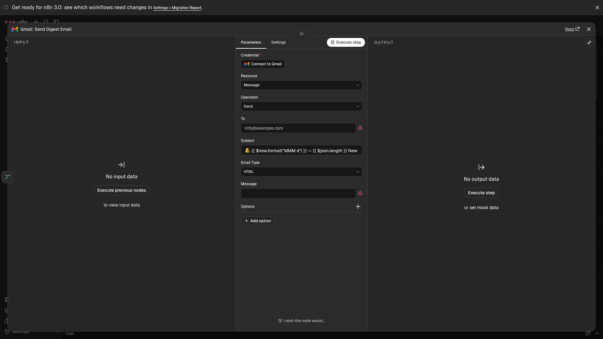
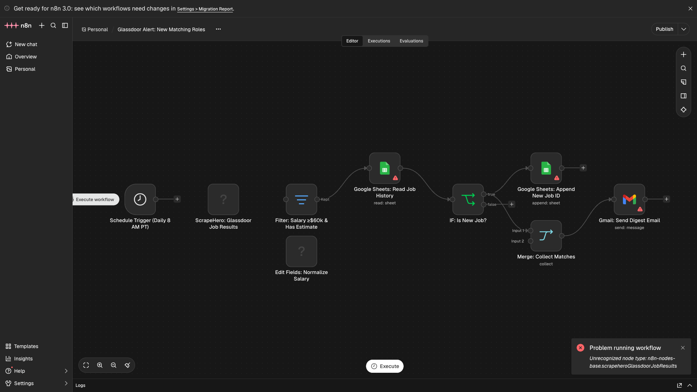

[SEO Meta]
Focus Keyword: Glassdoor job alerts n8n
SEO Title: Glassdoor Alert: New Matching Roles with n8n [Automation]
SEO Description: Build an n8n workflow that searches Glassdoor daily, filters by skills, location, and salary, and emails new matching roles automatically.
[/SEO Meta]

# Glassdoor Alert: New Matching Roles with n8n

Stop checking Glassdoor manually. Build an n8n workflow that searches for you, filters by your criteria, and emails new matching roles every morning—without duplicates.

## What You'll Build

A daily 8 AM PT workflow that:
- Searches Glassdoor for **Marketing**, **Graphic Designer**, and **Software Developer** roles in **California**, **New York**, and **Nevada** (9 searches total)
- Filters for salaries ≥ **$60,000/year** (ignores listings with no salary estimate)
- Tracks `job_listing_id` in Google Sheets to **never alert on the same job twice**
- Sends **one digest email** with all new matches to `madhu.dath@scrapehero.com`

## Prerequisites

- **n8n** (self-hosted or n8n.cloud)
- **ScrapeHero Glassdoor API access** — enabled on your ScrapeHero account
- **Google account** — for the deduplication sheet
- **Gmail account** — for sending alerts

## Step 1: Create the Deduplication Google Sheet

1. Open [Google Sheets](https://sheets.google.com) and create a new spreadsheet named **Glassdoor Job Alert History**.
2. In the first sheet (tab), rename it to **Job History**.
3. Add these headers in row 1:

| A | B | C |
|---|---|---|
| `job_listing_id` | `observed_at` | `title` |

4. Share the sheet with your n8n Google Sheets credential (the service account email if using one).
5. **Copy the spreadsheet ID** from the URL: `https://docs.google.com/spreadsheets/d/{SPREADSHEET_ID}/edit`
   - You'll select this sheet via n8n's Google Sheets picker—no need to paste the ID manually.

## Step 2: Add the Schedule Trigger

1. In n8n, create a new workflow named **Glassdoor Alert: New Matching Roles**.
2. Click **+** → search **"Schedule Trigger"** → add it.
3. Configure:
   - **Trigger Interval**: `Every Day`
   - **Hour**: `8` (this is UTC; for 8 AM PT use `15` in UTC during standard time, `16` during daylight time)
   - **Minute**: `0`
   - **Timezone**: `America/Los_Angeles`



## Step 3: Add ScrapeHero Glassdoor Job Results

1. Click **+** on the Schedule Trigger output → search **"ScrapeHero: Glassdoor Job Results"** → add it.
2. Select your **ScrapeHero credential** (or create one with your API key).
3. Configure **9 searches** — one per state/category combo:

| # | State | Category |
|---|-------|----------|
| 1 | California | Marketing |
| 2 | California | Graphic Designer |
| 3 | California | Software Developer |
| 4 | New York | Marketing |
| 5 | New York | Graphic Designer |
| 6 | New York | Software Developer |
| 7 | Nevada | Marketing |
| 8 | Nevada | Graphic Designer |
| 9 | Nevada | Software Developer |

4. For each search:
   - **Search Type**: `Job Search`
   - **Location**: select the state
   - **Job Category**: select the category
   - **Results Per Page**: `30`
   - **Max Pages**: `1`



> **Important**: Do not follow the API's `next` URL. The node handles pagination; set `Max Pages` to `1` for the latest 30 results per search.

## Step 4: Add the Filter Node

1. Click **+** on Glassdoor output → search **"Filter"** → add it.
2. Set **Mode** to `Manual` (or `Advanced` if you prefer expressions).
3. Add these conditions (all must match — **AND** logic):

| Field | Operation | Value |
|-------|-----------|-------|
| `salary_min_annual` | **≥ (Number)** | `60000` |
| `salary_estimate_source` | **Not Equal (String)** | `null` (or leave empty to exclude missing salaries) |

3. The Filter will pass only jobs with a parsed annual minimum ≥ $60,000 **and** a salary estimate present.



> **How salary parsing works**: The ScrapeHero node returns `salary_min`, `salary_max`, `salary_currency`, `salary_period`, and `salary_estimate_source`. The workflow includes a hidden **Edit Fields** node (or you can use expressions in Filter) that normalizes everything to `salary_min_annual`:
> - Annual: use as-is
> - Monthly: × 12
> - Hourly: × 2080 (40 hrs × 52 weeks)
> - Missing estimate → `salary_estimate_source` is empty/null → excluded by the second condition

## Step 5: Add Deduplication — Read Job History

1. Click **+** on Filter output (true branch) → search **"Google Sheets"** → add it.
2. Select your **Google Sheets credential**.
3. **Resource**: `Sheet` → **Operation**: `Read`.
4. Click the **Document** field → **Select from list** → choose **Glassdoor Job Alert History**.
5. **Sheet**: `Job History` (tab with the headers you created).
6. **Range**: `A:C` (or leave empty to read all).
7. **Options** → **Return All**: `true`.



This reads every `job_listing_id` ever alerted.

## Step 6: Add IF Node — Is This Job New?

1. Click **+** on Google Sheets (read) output → search **"IF"** → add it.
2. **Mode**: `Expression`.
3. **Condition**: check if the current job's `job_listing_id` is **not** in the history.

Expression (adjust field names to match your Glassdoor output):
```javascript
// Returns true if job is NEW (not in history)
const history = $node["Google Sheets (Read Job History)"].parameter.options.returnAll 
  ? $node["Google Sheets (Read Job History)"].json 
  : [];

const currentId = $json.job_listing_id;
return !history.some(row => row.job_listing_id === currentId);
```



- **True branch** → new job → continue to append + collect
- **False branch** → already alerted → stop (no connection needed)

## Step 7: Add Deduplication — Append New Job ID

1. On the **IF true** output → click **+** → search **"Google Sheets"** → add it.
2. Same credential, **Resource**: `Sheet` → **Operation**: `Append`.
3. **Document**: select **Glassdoor Job Alert History** via picker.
4. **Sheet**: `Job History`.
5. **Options** → **Value Input Mode**: `USER_ENTERED`.
6. **Map Automatically**: **ON** — this matches your Edit Fields output to the sheet headers.



7. Connect an **Edit Fields** node before this (or use the IF's output directly) with these fields:
   - `job_listing_id`: `={{ $json.job_listing_id }}`
   - `observed_at`: `={{ new Date().toISOString() }}`
   - `title`: `={{ $json.title }}`

## Step 8: Add Merge Node — Collect Matches for Digest

1. On the **IF true** output (after or parallel to Append) → click **+** → search **"Merge"** → add it.
2. **Mode**: `Append` (or `Collect` depending on n8n version).
3. **Include**: `All Inputs`.
4. This gathers every new matching job into one array for the email.



## Step 9: Add Gmail — Send Digest Email

1. Click **+** on Merge output → search **"Gmail"** → add it.
2. Select your **Gmail credential** (OAuth2).
3. **Resource**: `Message` → **Operation**: `Send`.
4. **To**: `madhu.dath@scrapehero.com` (use an expression if you want it configurable).
5. **Subject**: `🔔 {{ $now.format("MMM d") }} — {{ $json.length }} New Glassdoor Matches`
6. **Body (HTML)**: toggle to HTML and use a template like:

```html
<h2>{{ $json.length }} new matching roles found on {{ $now.format("MMMM d, yyyy") }}</h2>
<ul>
{{#each $json}}
  <li>
    <strong>{{ title }}</strong> — {{ company_name }}<br>
    📍 {{ location }} | 💰 ${{ salary_min_annual.toLocaleString() }}/yr ({{ salary_estimate_source }})<br>
    <a href="{{ job_url }}">View on Glassdoor</a>
  </li>
{{/each}}
</ul>
<p style="color:#666;font-size:0.9em;">You received this because you subscribed to Glassdoor alerts via n8n.</p>
```

7. **Options** → **Send As**: `HTML`.



## Step 10: Test the Workflow

1. Save the workflow.
2. Click **Execute Workflow** (manual run).
3. Check the execution log:
   - **Glassdoor**: 9 searches × ~30 results = ~270 jobs fetched
   - **Filter**: passes only ≥$60k with salary estimates
   - **IF true**: new jobs not in history
   - **Append**: writes new job IDs to sheet
   - **Merge**: collects matches
   - **Gmail**: sends one digest email



4. Run a **second time** immediately — the email should be empty (or not sent if you add a "no matches" check) because all jobs are now in history.


## Step 11: Activate (When Ready)

1. Toggle **Active** in the top-right.
2. The workflow will now run daily at 8 AM PT.

## Troubleshooting

| Issue | Fix |
|-------|-----|
| No jobs found | Verify ScrapeHero credential has Glassdoor Job Results API access enabled |
| Salary filter not working | Check `salary_min_annual` expression; log a sample Glassdoor item to inspect fields |
| Duplicate alerts | Ensure IF condition matches `job_listing_id` exactly; check Google Sheets read range |
| Gmail fails | Re-authenticate Gmail credential; check "Less secure apps" / OAuth consent |

## FAQ

### Can I add more states or categories?
Yes—add more searches in the Glassdoor node. Each search is one state + one category.

### What if a job's salary is listed as a range ($70k–$90k)?
The node parses `salary_min` and `salary_max`. The filter uses `salary_min_annual` (normalized), so a $70k–$90k job passes the ≥$60k check.

### What about hourly or monthly salaries?
The normalization (in Edit Fields or Filter expression) converts:
- Monthly × 12
- Hourly × 2080
- Annual as-is

### Can I use a different email address?
Yes—change the **To** field in the Gmail node. For production, consider an n8n environment variable.

### Does this work on n8n.cloud?
Yes. All nodes used are available on n8n.cloud.

### What if I want separate emails per job?
Change the Merge node to pass items individually and connect Gmail directly to IF true (remove Merge). Add a Loop Over Items if needed.

## Workflow Export

Download the workflow JSON: [workflow.json](workflow.json)

Import in n8n → **Workflows** → **Import** → select the file. Replace credential placeholders with your actual credentials.

---

*Built with n8n and ScrapeHero. Automate your job search.*