[SEO Meta]
Focus Keyword: Glassdoor salary range tracker
SEO Title: Glassdoor Salary Range Tracker [Log Job Estimates in Google Sheets]
SEO Description: Track Glassdoor salary estimates by job ID with n8n and ScrapeHero, split ranges into numeric minimums and maximums, and save each observation to Google Sheets.
[/SEO Meta]

# How to Build a Glassdoor Salary Range Tracker With n8n and ScrapeHero

Glassdoor salary estimates can change as listings are updated, but manually checking the same job searches makes it difficult to see what changed and when. A **Glassdoor salary range tracker** can capture each search on a schedule, split the estimate into numeric minimum and maximum values, and keep a dated salary history in Google Sheets.

This tutorial shows how to build an n8n workflow that:

1. Reads Glassdoor search URLs, job categories, and states from Google Sheets.
2. Retrieves the job listings for each URL with ScrapeHero's Glassdoor Job Results API.
3. Splits the results into individual jobs and parses each `estimated_salary` range.
4. Appends every observation to a history sheet using the Glassdoor job listing ID.

### Key Takeaways

- The ScrapeHero node uses the **Glassdoor Job Results API** and the search URL supplied in the input sheet.
- The API returns a `job_details` array; **Split Out** turns each job into an individual item.
- The workflow parses `estimated_salary` into numeric **Salary Min** and **Salary Max** fields and keeps the original estimate.
- `job_listing_id` becomes **Job ID**, while each scheduled run adds a new row instead of overwriting previous salary observations.
- Currency and pay period remain separate, so hourly and annual estimates are not compared as if they used the same period.
- The provided workbook has statewide search rows for California, New York, and Nevada across marketing, graphic design, and software development.

## Before You Begin

Prepare the following:

1. An n8n instance with permission to install or use the ScrapeHero community node.
2. A ScrapeHero account with access and credits for the Glassdoor Job Results API.
3. A Google account connected to n8n through a Google Sheets OAuth2 credential.
4. The [Glassdoor Salary Tracker upload template](../../Glassdoor_Salary_Tracker_Google_Sheets_Ready.xlsx), uploaded to Google Drive and opened as a Google Sheet. The Google account connected to n8n must be able to open it.
5. The workbook available in n8n's Google Sheets picker. You do not need to copy the spreadsheet ID.

The **Search URLs** tab contains `State`, `Job Category`, and `Search URL` columns. The workbook includes nine statewide searches: three job categories for each of the three selected states.

| State | Job Category | Search URL |
| :--- | :--- | :--- |
| California | Marketing | `https://www.glassdoor.com/Job/california-marketing-jobs-SRCH_IL.0,10_IS2280_KO11,20.htm` |
| California | Graphic Designer | Use the matching row in the uploaded workbook |
| California | Software Developer | Use the matching row in the uploaded workbook |

Keep the **Salary History** tab's header row intact. It includes the fields the final Google Sheets node writes:

| Observed At | Job ID | Job Title | Company | Location | State | Job Category | Estimated Salary | Salary Min | Salary Max | Currency | Pay Period | Estimated By | Job URL | Search URL |
| :--- | :--- | :--- | :--- | :--- | :--- | :--- | :--- | ---: | ---: | :--- | :--- | :--- | :--- | :--- |
| Generated on each run | `1009556241633` | Software Developer - AI Trainer | DataAnnotation | Boston, MA | Massachusetts | Software Developer | `$40 - $40` | 40 | 40 | USD | HOURLY | Employer Est | `https://www.glassdoor.com/job-listing/software-developer-ai-trainer-dataannotation-JV_IC1154532_KO0,29_KE30,44.htm?jl=1009556241633` | `https://www.glassdoor.com/Job/boston-software-engineer-jobs-SRCH_IL.0,6_IC1154532_KO7,24.htm?srs=RECENT_SEARCHES` |

The sample row illustrates the API fields and parsed values. **Observed At** is generated by n8n at runtime; the remaining sample values come from the API response example.

## Build the Workflow

### 1. Add a Schedule Trigger

Start with the node that sets the snapshot cadence. Click the **plus icon** (+), search for **Schedule Trigger**, and add it.

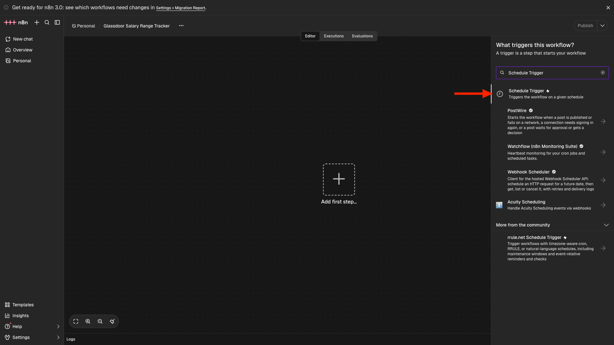

Set the trigger to run every day at **06:00** in the n8n instance's timezone.

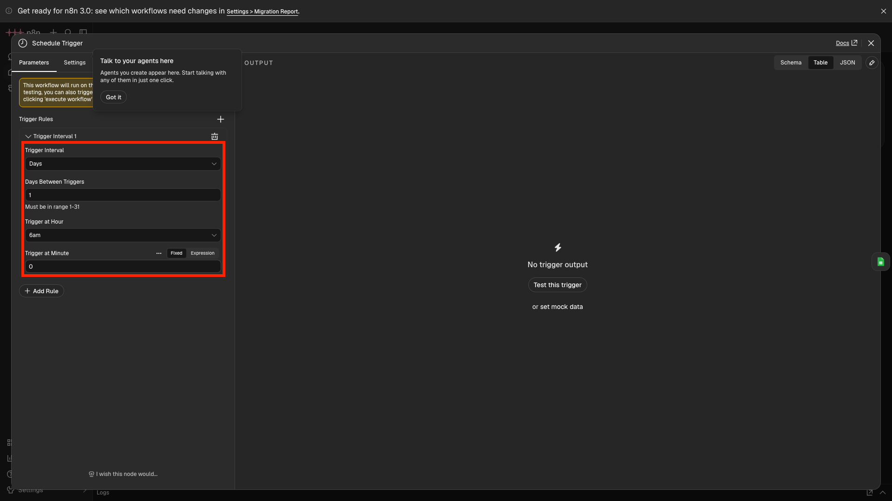

### 2. Read the Search URLs from Google Sheets

Click the Schedule Trigger's **plus icon** (+), search for **Google Sheets**, and choose **Get row(s) in sheet**.

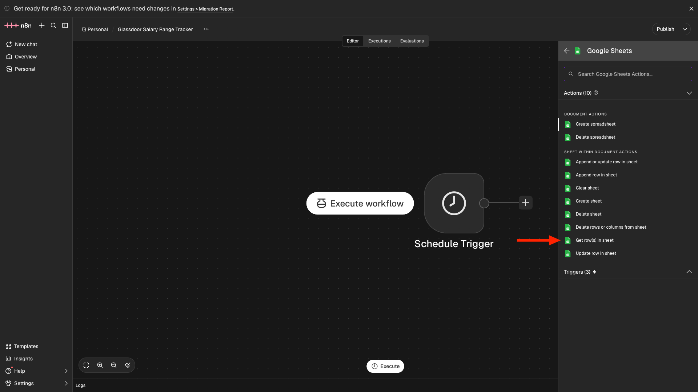

Connect the Google Sheets OAuth2 credential. Open the **Document** list and choose the uploaded workbook, then open the **Sheet** list and choose **Search URLs**. Both lists are populated from your Google Drive, so no spreadsheet ID is needed. The first row must contain the exact headers `State`, `Job Category`, and `Search URL`.

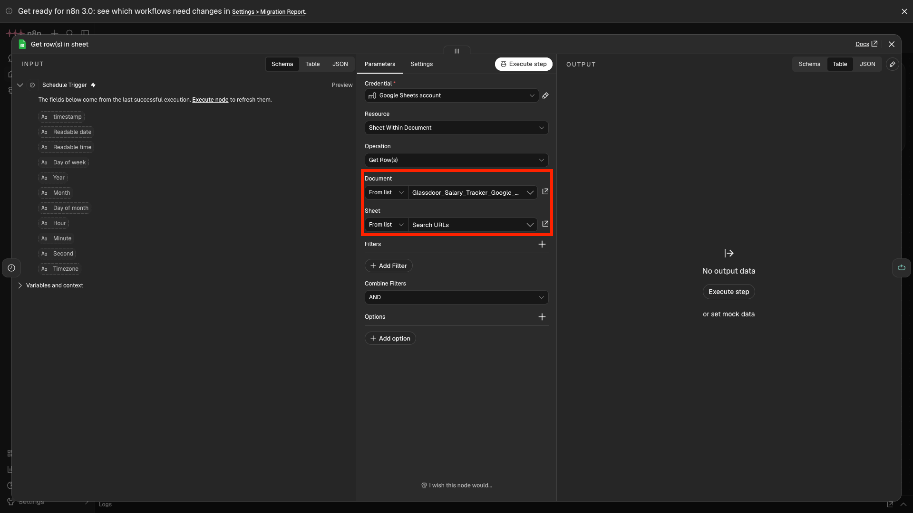

The workflow reads every populated row. Each row supplies the job search URL and the state/category labels that will be copied into the history record.

### 3. Process One Search URL at a Time

Add **Loop Over Items** after the Google Sheets node.

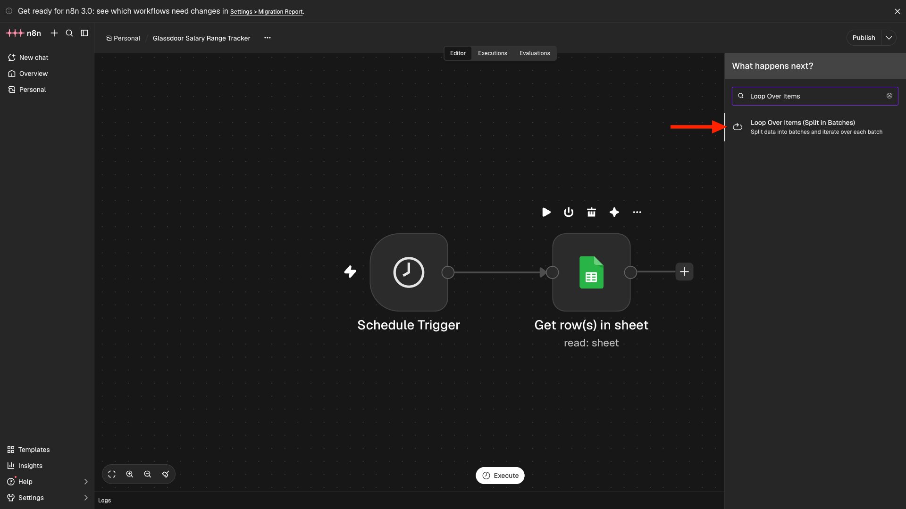

Keep the default batch size of `1`. Connect the **loop** output to ScrapeHero; the **done** output remains unconnected because the workflow has no later step after all searches finish.

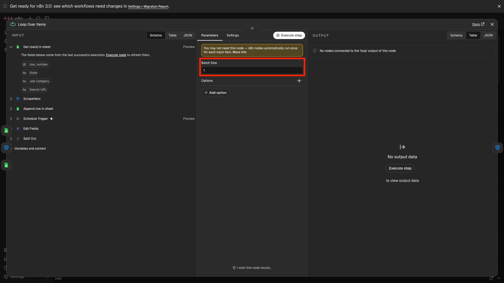

### 4. Fetch Glassdoor Job Listings with ScrapeHero

From the Loop Over Items **loop** output, add the **ScrapeHero** node.

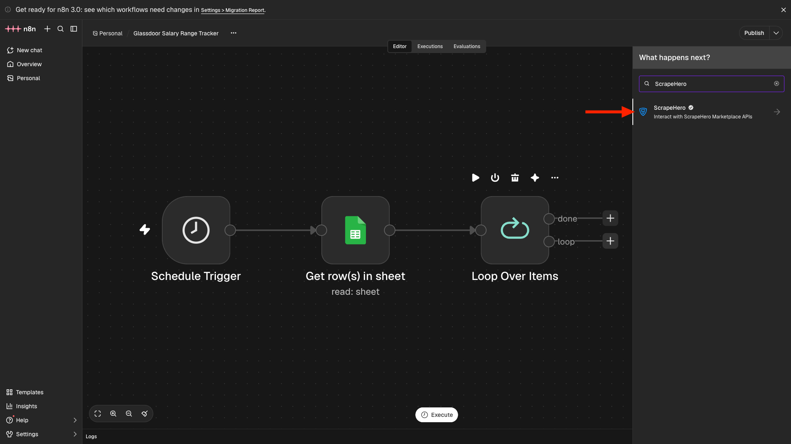

Create or select a ScrapeHero credential:

1. Go to [app.scrapehero.com](https://app.scrapehero.com/).
2. Sign in to your account.
3. Click your profile icon.
4. Open the **API Key** page.
5. Copy your API key.
6. Return to n8n and select **Create New Credential** for the ScrapeHero node.
7. Paste the key into the credential field. Keep the key private; the field should remain masked in screenshots.
8. Save the credential.

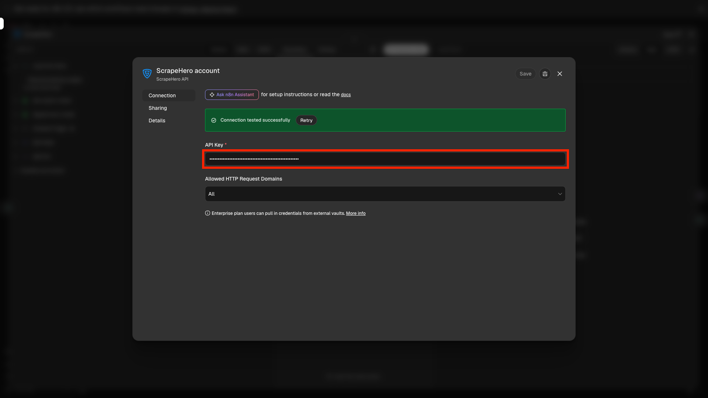

Configure the node to use **Glassdoor Job Results API**. In **Job Search URL**, switch to expression mode and enter:

```javascript
={{ $json["Search URL"] }}
```

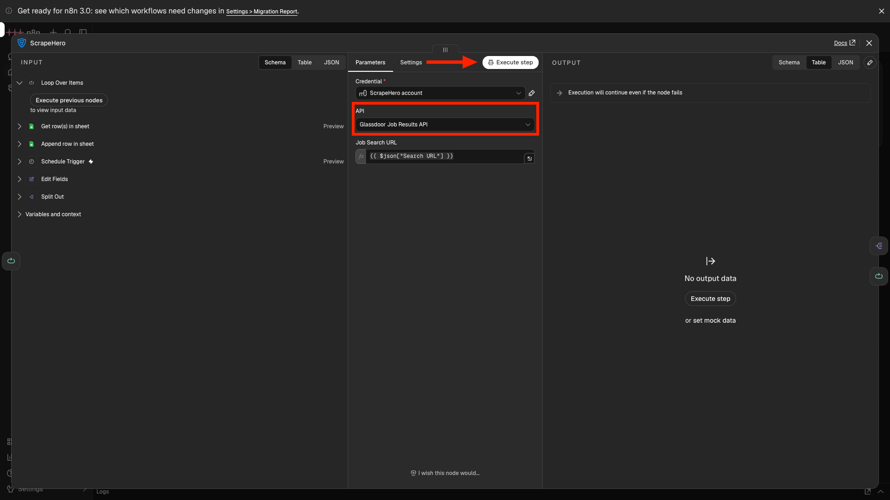

The API returns a `job_details` array with fields such as `job_listing_id`, `job_title`, nested company and location details, `estimated_salary`, `estimated_by`, `pay_currency`, and `pay_period`. The workflow uses the URL in the sheet for each API call. It does not use a `next` URL. Click **Execute Step** to confirm the response before moving on.

After testing the node with a single search row, pin the returned data while configuring the downstream nodes. This avoids repeating API calls during setup.

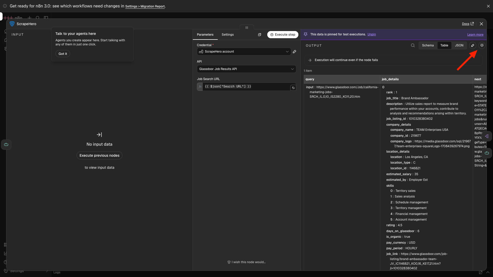

## Parse the Salary Range

### 5. Split the `job_details` Array

Add **Split Out** after ScrapeHero.

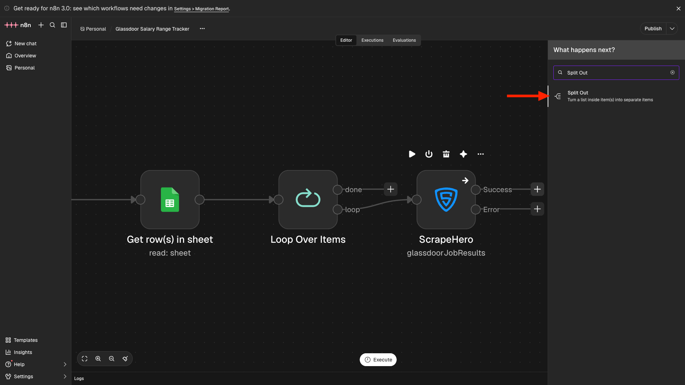

Set **Fields To Split Out** to:

```text
job_details
```

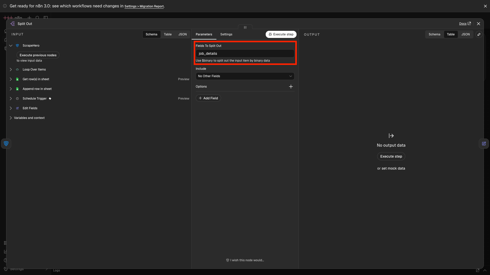

Each output item now represents one job listing. The minimum and maximum values are not an array in the API response; they are parsed from the `estimated_salary` string in the next node.

### 6. Map Job Fields and Parse the Minimum and Maximum

Add **Edit Fields** after Split Out.

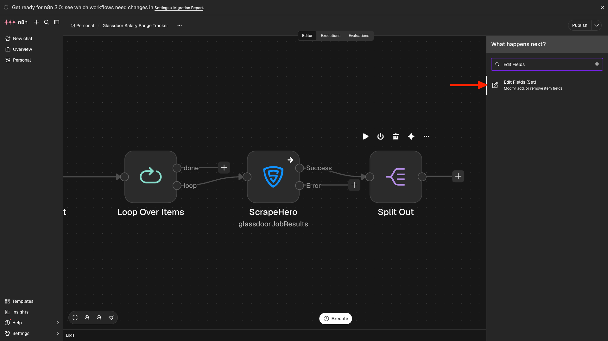

Create the fields below. Set **Salary Min** and **Salary Max** to the **Number** type; keep the other values as strings.

| Output field | Source or expression | Type |
| :--- | :--- | :--- |
| Observed At | `={{ $now.toISO() }}` | String |
| Job ID | `={{ String($json.job_listing_id ?? '') }}` | String |
| Job Title | `={{ $json.job_title ?? '' }}` | String |
| Company | `={{ $json.company_details?.company_name ?? '' }}` | String |
| Location | `={{ $json.location_details?.location ?? '' }}` | String |
| State | `={{ $('Loop Over Items').item.json.State }}` | String |
| Job Category | `={{ $('Loop Over Items').item.json["Job Category"] }}` | String |
| Estimated Salary | `={{ $json.estimated_salary ?? '' }}` | String |
| Salary Min | Use the expression below | Number |
| Salary Max | Use the expression below | Number |
| Currency | `={{ $json.pay_currency ?? '' }}` | String |
| Pay Period | `={{ $json.pay_period ?? '' }}` | String |
| Estimated By | `={{ $json.estimated_by ?? '' }}` | String |
| Job URL | `={{ $json.job_link ?? '' }}` | String |
| Search URL | `={{ $('Loop Over Items').item.json["Search URL"] }}` | String |

For **Salary Min**, use:

```javascript
={{ $json.estimated_salary && ($json.estimated_salary.match(/[\d,.]+/g) || [])[0] ? Number($json.estimated_salary.match(/[\d,.]+/g)[0].replace(/,/g, '')) * (/\d[\d,.]*\s*[Kk]/.test($json.estimated_salary) ? 1000 : 1) : null }}
```

For **Salary Max**, use:

```javascript
={{ $json.estimated_salary && ($json.estimated_salary.match(/[\d,.]+/g) || [])[0] ? Number((($json.estimated_salary.match(/[\d,.]+/g) || [])[1] || $json.estimated_salary.match(/[\d,.]+/g)[0]).replace(/,/g, '')) * (/\d[\d,.]*\s*[Kk]/.test($json.estimated_salary) ? 1000 : 1) : null }}
```

The expressions remove currency symbols and thousands separators, return numeric values, and account for a `K` suffix. A single numeric amount is used for both minimum and maximum. If `estimated_salary` is `null`, both values stay empty; the job row is still retained. Keep **Pay Period** as a separate field instead of converting hourly rates into annual estimates.

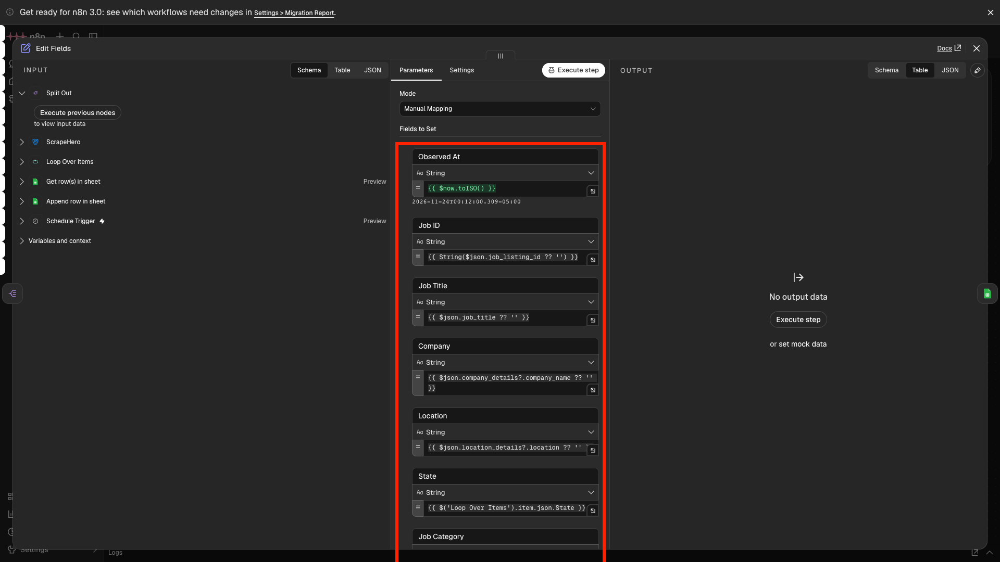

## Append Salary History to Google Sheets

### 7. Add the Append Row Node

Add a **Google Sheets** node after Edit Fields and choose **Append row in sheet**.

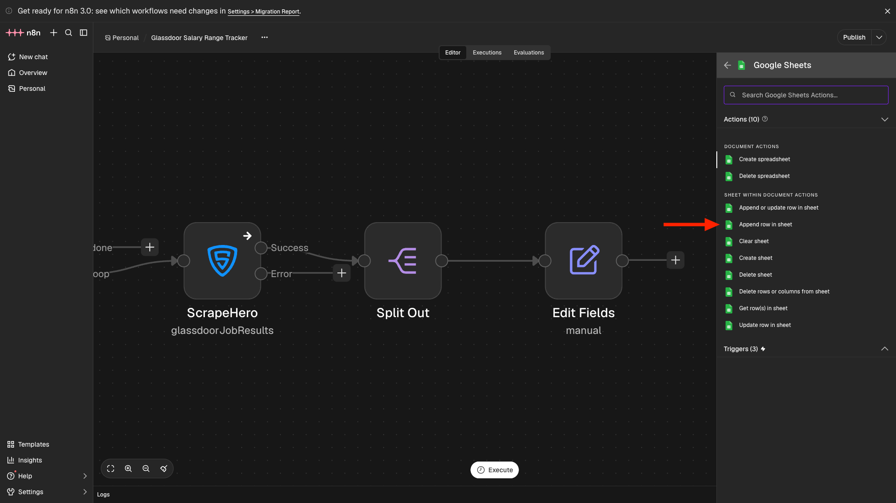

Choose the same workbook from the **Document** list, choose the **Salary History** tab from the **Sheet** list, and set the mapping mode to **Map Automatically**. The field names from Edit Fields must match the header row exactly.

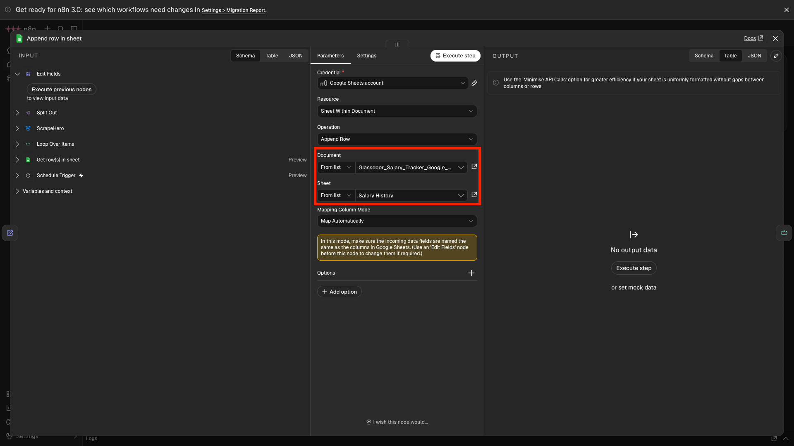

Use **Append Row**, not an upsert or update operation. Each run creates a new observation for a job ID, preserving the salary history instead of replacing the previous estimate.

### 8. Complete the Loop

Connect **Append row in sheet** back to the **Loop Over Items** input. This starts processing the next search URL. The ScrapeHero node is configured to continue on an error; connect its error output back to the same loop input so one failed query does not stop the remaining searches.

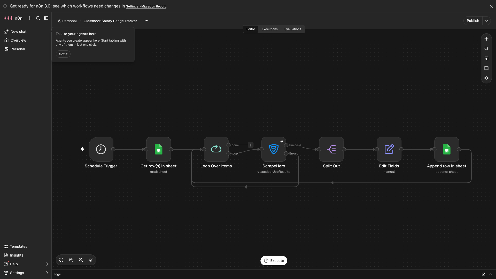

## Test the Workflow

Before running all nine searches, make a copy of the spreadsheet for testing and leave one search row in its **Search URLs** tab.

1. Select the Google Sheets and ScrapeHero credentials in both Google Sheets nodes and the ScrapeHero node.
2. Confirm that both Google Sheets nodes use the workbook you chose from the **Document** list and the correct tab from the **Sheet** list.
3. Execute the workflow manually. Confirm that ScrapeHero returns `job_details` and Split Out emits one item per listing.
4. Inspect **Salary Min**, **Salary Max**, **Currency**, and **Pay Period** in Edit Fields. Check a ranged salary, a single-value salary, and a job whose estimate is null.
5. Confirm that the Append node adds rows under the existing headers in **Salary History**.
6. Run the same search again. The workflow should append another observation instead of replacing existing rows.

The example API response includes `"$40 - $40"` for an hourly job, `"$94224 - $135217"` for an annual job, and a listing with no salary estimate. These cases demonstrate why the raw estimate, numeric range, currency, and pay period are stored separately.

The workflow processes the results returned for each supplied search URL. It does not follow a pagination `next` URL.

## What This Unlocks for Your Business

- **Track estimate changes:** Compare dated salary observations for the same `Job ID`.
- **Benchmark locations:** Compare Glassdoor salary estimates across California, New York, and Nevada.
- **Compare job families:** Review marketing, graphic designer, and software developer compensation in a single sheet.
- **Keep pay units clear:** Filter hourly and annual estimates without mixing the periods.
- **Build a reusable dataset:** Extend the search list and connect the results to reporting tools. Explore the [Glassdoor Job API on ScrapeHero Marketplace](https://www.scrapehero.com/marketplace/glassdoor-job-api/).

## Next Steps

- **Add states:** Add more state/category/search URL rows to **Search URLs**.
- **Change the cadence:** Adjust the Schedule Trigger to capture estimates more or less often.
- **Build a dashboard:** Connect the history tab to a reporting tool and chart min/max changes by job ID.
- **Add alerts:** Notify a channel when a tracked estimate changes beyond a chosen threshold.

## Wrapping Up

This workflow turns recurring Glassdoor job searches into a structured salary history. The job listing ID ties observations together, while the timestamp and pay details make changes easier to review.

Start with the [ScrapeHero Glassdoor Job API](https://www.scrapehero.com/marketplace/glassdoor-job-api/) and an API key, then use the uploaded workbook as the search and history template. Test one search URL before enabling the full schedule.

For custom coverage, we can build managed data collection around your job categories, locations, delivery schedule, and downstream systems. Learn more about [ScrapeHero's data services](https://www.scrapehero.com/services/).

## Frequently Asked Questions

### What is the Glassdoor job ID used for in the salary tracker?

The API returns `job_listing_id`. The workflow stores it as **Job ID**, which lets the sheet associate later observations with the same Glassdoor listing.

### Does the workflow overwrite the previous salary estimate?

No. The Google Sheets node uses **Append Row**, so each scheduled run adds an observation and keeps earlier rows.

### What happens when Glassdoor has no salary estimate?

The job is still appended. **Estimated Salary**, **Salary Min**, and **Salary Max** are blank, while the job ID and other returned fields are retained.

### Does the workflow follow the API's `next` URL?

No. It uses the Glassdoor search URL supplied to the ScrapeHero node and records the jobs returned for that request. It does not use an HTTP Request node or follow a `next` URL.
