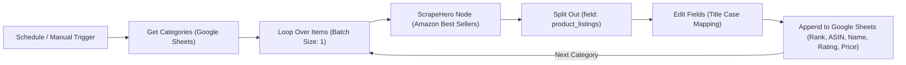

# Implementation Plan: Amazon Best Seller Category Best-Sellers Logger Workflow

## Goal Description
Build a production-grade n8n automation workflow that logs Amazon Category Best-Sellers into Google Sheets. The workflow fetches category rankings using ScrapeHero's Amazon Best Sellers endpoint, unpacks the `product_listings` array, formats the target attributes (`rank`, `asin`, `name`, `rating`, `sale_price`), and appends the records into a Google Spreadsheet logger.



---

## User Review Required

> [!IMPORTANT]
> **SEO & Content Strategy Alignment**:
> - **Primary Keyword**: `Track Amazon bestseller rankings`
> - **Suggested SEO Title**: `Rank Tracking for Amazon Best Sellers [Automate Daily Tracking with n8n]`
> - **AEO Question Headers**: Integrated into workflow documentation and planned tutorial sections.

> [!NOTE]
> **Google Sheets Operation**:
> Per your specification, this workflow performs an **Append** operation (`append`), preserving historical rank tracking over time. Each run appends timestamped records for trend analysis.

---

## Open Questions

1. **Trigger Frequency**:
   - Would you like the default Schedule Trigger set to **Daily at Midnight (00:00)** or an **hourly / interval** rule?

---

## Proposed Changes

### Directory Structure & Files

The project artifacts will be organized into:
- `plans/amazon_best_seller_workflow_plan.md`
- `workflows/Amazon Best Seller Logger/workflow.json`
- `workflows/Amazon Best Seller Logger/seo_suggestions.md`
- `articles/amazon-category-best-sellers-logger/config.json`
- `articles/amazon-category-best-sellers-logger/api_sample.json`
- `articles/amazon-category-best-sellers-logger/seo_suggestions.md`
- `articles/amazon-category-best-sellers-logger/workflow.json`

---

### Component 1: SEO Suggestions Configuration

#### [NEW] `workflows/Amazon Best Seller Logger/seo_suggestions.md`
#### [NEW] `articles/amazon-category-best-sellers-logger/seo_suggestions.md`

```markdown
# Primary KW (Volume - KD - Intent)

Track Amazon bestseller rankings

# Secondary KWs (Volume - KD - Intent)

Amazon Best Seller API
Amazon category rank tracking
Amazon bestseller ranking history
Amazon product ranking monitoring
Track Amazon bestsellers
Amazon n8n workflow
Amazon rank tracking with n8n

# Google People Also Ask

How to check Amazon best sellers rank?
How to get best seller rank on Amazon?
How do I track Amazon Best Seller Rank changes?
How do I send API data to Google Sheets using n8n?
How often does Amazon update its Best Seller rankings?
How can I monitor competing products in Amazon bestseller categories?

# Related Searches

Amazon bestsellers scraper
Scrape amazon product data
Amazon Best Seller API
Amazon product search API
Amazon product ranking monitoring
Amazon category best sellers list
Amazon bestseller data

# AI-Search (AEO) Question Keywords (Use these as your H2 or H3 headers)

How to automate Amazon Best Seller rank tracking using n8n?
How to track Amazon Best Sellers across multiple product categories?
How to extract Amazon bestseller product data using ScrapeHero API?
How to monitor changes in Amazon bestseller rankings over time?
How to collect Amazon category bestseller data automatically?
How to store daily Amazon bestseller rankings in Google Sheets using n8n?
How to create a historical database of Amazon category rankings?
How to use Amazon bestseller data for competitor and market research?

# Suggested SEO Title (With Brackets)

Rank Tracking for Amazon Best Sellers [Automate Daily Tracking with n8n]
Rank Tracking for Amazon Best Sellers[Schedule Daily Best Seller Data Collection]

# Internal Links

https://www.scrapehero.com/amazon-scraping-apis/
https://www.scrapehero.com/scrape-amazon-product-details-using-python/
https://www.scrapehero.com/automate-amazon-product-scraping-with-n8n-and-scrapehero/
https://www.scrapehero.com/n8n-amazon-price-tracker-to-find-the-lowest-offer-price/
```

---

### Component 2: Verified ScrapeHero API Response

#### [NEW] `articles/amazon-category-best-sellers-logger/api_sample.json`
Stores the real ScrapeHero Amazon Best Sellers API sample:

```json
{
  "category": "Electronics",
  "product_listings": [
    {
      "rank": 1,
      "asin": "B0791TX5P5",
      "name": "Fire TV Stick streaming media player with Alexa built in, includes Alexa Voice Remote, HD, easy set-up, released 2019",
      "ratings_count": 191042,
      "rating": "4.5",
      "sale_price": "$39.99 - $74.98",
      "image": "https://images-na.ssl-images-amazon.com/images/I/51ZdmnHKukL._AC_UL200_SR200,200_.jpg",
      "is_prime": false,
      "product_url": "https://www.amazon.com/Fire-TV-Stick-with-Alexa-Voice-Remote/dp/B0791TX5P5/ref=zg_bs_electronics_1?_encoding=UTF8&psc=1&refRID=HGTDEZQFV03MQVMCPD44"
    },
    {
      "rank": 2,
      "asin": "B07FZ8S74R",
      "name": "Echo Dot (3rd Gen) - Smart speaker with Alexa - Charcoal",
      "ratings_count": 369774,
      "rating": "4.7",
      "sale_price": "$49.99 - $89.98",
      "image": "https://images-na.ssl-images-amazon.com/images/I/6182S7MYC2L._AC_UL200_SR200,200_.jpg",
      "is_prime": false,
      "product_url": "https://www.amazon.com/Echo-Dot/dp/B07FZ8S74R/ref=zg_bs_electronics_2?_encoding=UTF8&psc=1&refRID=HGTDEZQFV03MQVMCPD44"
    }
  ],
  "child_categories": [
    {
      "category": "Accessories & Supplies",
      "url": "https://www.amazon.com/Best-Sellers-Electronics-Accessories-Supplies/zgbs/electronics/281407/ref=zg_bs_nav_e_1_e"
    }
  ],
  "next": "https://get.scrapehero.com/amz/best-sellers/?url=https%3A//www.amazon.com/Best-Sellers-Electronics/zgbs/electronics/ref%3Dzg_bs_pg_2%3F_encoding%3DUTF8%26pg%3D2",
  "url": "https://www.amazon.com/Best-Sellers-Electronics/zgbs/electronics/&pg=1"
}
```

---

### Component 3: Article & Workflow Configuration

#### [NEW] `articles/amazon-category-best-sellers-logger/config.json`

```json
{
  "platform": "Amazon",
  "automation_tool": "n8n",
  "storage": "Google Sheets",
  "workflow_description": "Extracts Amazon Category Best Sellers using ScrapeHero, unpacks product_listings, and appends rank, ASIN, product name, rating, and sale_price to Google Sheets.",
  "scrapehero": {
    "api_selection": "Amazon Best Seller",
    "unique_identifier": "asin",
    "node_parameters": {
      "apiSelection": "Amazon Best Seller",
      "categoryUrl": "={{ $json['Category URL'] }}",
      "countryCode": "US"
    },
    "api_json_output_file": "api_sample.json"
  },
  "business_benefits": [
    "Identify fast-moving and trending products across key Amazon categories in real time.",
    "Track competitor rank movements and pricing shifts over time without manual checks.",
    "Uncover niche subcategory opportunities from child category rankings.",
    "Build proprietary historical Best Seller Rank (BSR) datasets for predictive forecasting.",
    "Streamline inventory restocking by prioritizing high-velocity category leaders."
  ],
  "seo_suggestions_file": "seo_suggestions.md"
}
```

---

### Component 4: n8n Workflow Implementation

#### [NEW] `workflows/Amazon Best Seller Logger/workflow.json`
Production-grade n8n workflow complying with `.agents/rules/n8n-best-practices.md`:

1. **Schedule Trigger (`n8n-nodes-base.scheduleTrigger`)**:
   - Triggers daily scheduled run.
2. **Google Sheets - Get Categories (`n8n-nodes-base.googleSheets`)**:
   - Operation: `getAll` / reads category tracking list from `Categories` sheet.
3. **Loop Over Items (`n8n-nodes-base.splitInBatches`)**:
   - Batch size: `1` to isolate each category execution.
4. **ScrapeHero Node (`n8n-nodes-scrapehero.scrapeHero`)**:
   - Fetches Best Sellers using ScrapeHero API with dynamic category URL `={{ $json['Category URL'] }}`.
5. **Split Out (`n8n-nodes-base.splitOut`)**:
   - `fieldToSplitOut`: `product_listings`.
6. **Edit Fields (`n8n-nodes-base.set`)**:
   - Maps raw API properties to clean Title Case column names:
     - `Category`: `={{ $('ScrapeHero').item.json.category || $('Loop Over Items').item.json['Category Name'] }}`
     - `Rank`: `={{ $json.rank }}`
     - `ASIN`: `={{ $json.asin }}`
     - `Product Name`: `={{ $json.name }}`
     - `Rating`: `={{ $json.rating }}`
     - `Price`: `={{ $json.sale_price }}`
     - `Ratings Count`: `={{ $json.ratings_count }}`
     - `Logged Date`: `={{ $now.toFormat('yyyy-MM-dd HH:mm:ss') }}`
7. **Append row in sheet (`n8n-nodes-base.googleSheets`)**:
   - Operation: `append`
   - Target Sheet: `Best Sellers Log`
8. **Loopback**:
   - Completes the loop back into `Loop Over Items`.

---

## Verification Plan

### Automated Tests
Run workflow validator against repository rules:
```bash
python validate_workflow.py "workflows/Amazon Best Seller Logger/workflow.json"
```

Expected output:
- `Split Out` node detected unpacking `product_listings`.
- Title Case mappings verified with zero raw snake_case columns.
- All connections valid and free of circular errors.

### Manual Verification
1. Import `workflow.json` into n8n.
2. Verify node layout, parameter groupings, and credentials placeholder assignments.
3. Test execute a single category row and verify data appended to Google Sheets.
